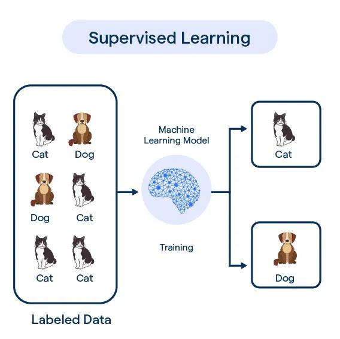
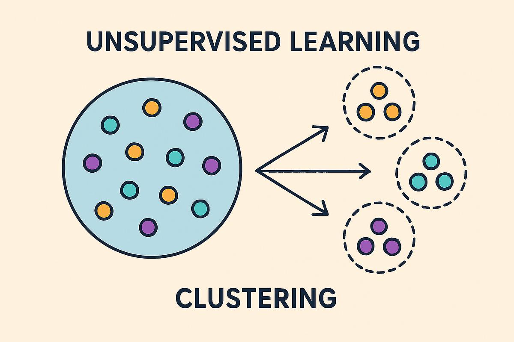
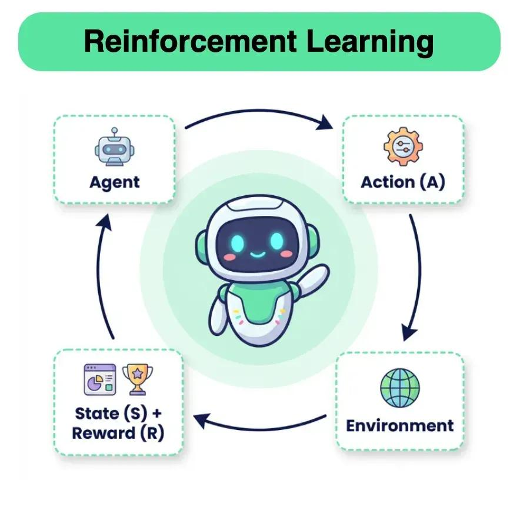
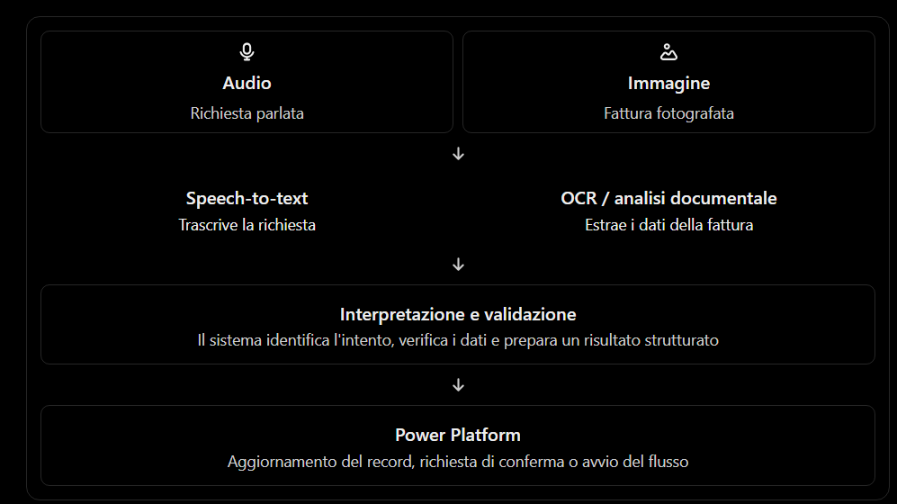
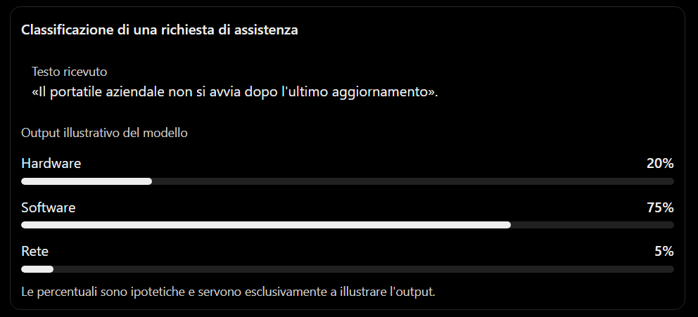
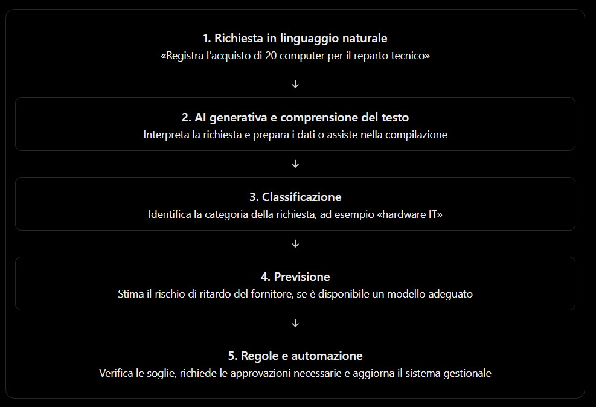

# Intelligenza artificiale: evoluzione, tecnologie e applicazioni nel contesto di Microsoft Power Platform Copilot

L'obiettivo è comprendere come si è evoluta l'intelligenza artificiale, quali tecnologie ne costituiscono le fondamenta e in che modo queste tecnologie vengono utilizzate in strumenti come Microsoft Copilot, Power Apps, Power Automate e Power BI.

Per affrontare correttamente l'argomento, è importante distinguere tre livelli:

- Fondamenti dell'AI: che cosa significa costruire sistemi capaci di svolgere attività associate all'intelligenza umana.
- Tecnologie dell'AI: regole, Machine Learning, Deep Learning, elaborazione del linguaggio naturale, visione artificiale e modelli generativi.
- Applicazione alla Power Platform: come queste tecnologie permettono di creare applicazioni, automatizzare processi, analizzare dati e interagire con i sistemi aziendali attraverso il linguaggio naturale.

## 1. Evoluzione dell'intelligenza artificiale

### 1.1 Che cos'è l'intelligenza artificiale

L'Intelligenza Artificiale, o Artificial Intelligence (AI), è un insieme di discipline, metodi e tecnologie che consentono a un sistema informatico di svolgere attività che normalmente richiedono capacità cognitive umane.

Tra queste attività troviamo:

- Comprendere e interpretare il linguaggio.
- Riconoscere immagini, oggetti, suoni e documenti.
- Identificare relazioni e schemi nei dati.
- Formulare previsioni.
- Classificare informazioni.
- Generare testi, immagini, codice e altri contenuti.
- Pianificare azioni e supportare decisioni.

Un sistema di AI non deve necessariamente imitare il funzionamento del cervello umano. È sufficiente che utilizzi metodi computazionali per affrontare un problema che richiede una qualche forma di percezione, apprendimento, ragionamento o generazione.

Per esempio, un modello che prevede il rischio di ritardo di una consegna sta utilizzando l'AI anche se non conversa con nessuno. Analogamente, un assistente che crea una bozza di flusso in Power Automate a partire da una richiesta in italiano utilizza capacità differenti, legate soprattutto alla comprensione e alla generazione del linguaggio.

### 1.2 Le principali tappe storiche

Anni 1940–1950: le basi teoriche

Si sviluppano i primi fondamenti dell'informatica moderna. Nel 1950 Alan Turing pubblica il suo lavoro sulla possibilità che le macchine manifestino un comportamento intelligente, introducendo il celebre test di Turing.

Idea chiave: definire e studiare l'intelligenza delle macchine.

Anni 1950–1970: AI simbolica e sistemi basati su regole

La ricerca si concentra sulla rappresentazione esplicita della conoscenza, sulla logica e sulle regole. I programmi possono risolvere problemi circoscritti se le informazioni e le procedure necessarie sono state definite in anticipo.

Idea chiave: rappresentare la conoscenza attraverso simboli, fatti e regole.

Anni 1970–1990: sistemi esperti

Si diffondono applicazioni che codificano le conoscenze di specialisti in specifici domini, come diagnosi tecniche, configurazione di prodotti e supporto decisionale. Le aspettative spesso superano i risultati pratici e alcuni limiti economici e tecnici contribuiscono ai cosiddetti inverni dell'AI.

Idea chiave: automatizzare decisioni specialistiche in domini circoscritti.

Anni 1990–2010: Machine Learning e approccio basato sui dati

Diventano sempre più importanti gli algoritmi capaci di apprendere relazioni dai dati, invece di dipendere esclusivamente da regole scritte da programmatori. Si diffondono metodi statistici, alberi decisionali, support vector machine e reti neurali.

Idea chiave: ricavare modelli e regolarità dagli esempi.

Anni 2010: Deep Learning

La disponibilità di grandi quantità di dati, acceleratori hardware e nuove architetture neurali favorisce progressi nel riconoscimento delle immagini, nel parlato e nella traduzione automatica. Nel 2017 viene presentata l'architettura Transformer, fondamentale per molti modelli linguistici successivi.

Idea chiave: apprendere rappresentazioni complesse attraverso reti neurali profonde.

Dal 2020 a oggi: AI generativa e Copilot

I modelli fondazionali e i Large Language Models (LLM) rendono possibile generare testi, codice, riepiloghi e risposte articolate. L'AI viene integrata negli strumenti di produttività e nei processi aziendali, spesso combinando modelli linguistici, dati aziendali, connettori e azioni automatizzate.

Idea chiave: interagire con le capacità dell'AI attraverso richieste in linguaggio naturale.

### 1.3 Come cambia il paradigma dell'AI

L'evoluzione non è una sostituzione completa di una tecnologia con la successiva. Le diverse famiglie continuano a convivere.

| Approccio                 | Come funziona                                                 | Esempio aziendale                                          |
| ------------------------- | ------------------------------------------------------------- | ---------------------------------------------------------- |
| AI basata su regole       | Applica condizioni e regole esplicite                         | Se una fattura supera una soglia, richiedi un'approvazione |
| Machine Learning          | Apprende relazioni dai dati                                   | Prevede quali clienti potrebbero abbandonare il servizio   |
| Deep Learning             | Apprende rappresentazioni complesse con reti neurali profonde | Riconosce testo e oggetti in immagini                      |
| AI generativa             | Genera nuovi contenuti sulla base di un modello appreso       | Produce una bozza di applicazione da una descrizione       |
| AI con strumenti e azioni | Combina modelli, dati e strumenti operativi                   | Interpreta una richiesta e avvia un flusso autorizzato     |

Nel contesto Power Platform, una soluzione reale può usare contemporaneamente tutti questi approcci: un modello generativo interpreta una richiesta, un flusso applica regole aziendali, un servizio predittivo stima un rischio e un connettore interagisce con un sistema gestionale.

### 1.4 Perché questa evoluzione è importante per Copilot

In passato, per automatizzare un processo era spesso necessario conoscere nel dettaglio il linguaggio di programmazione, le API e la struttura tecnica dell'applicazione.

Con Copilot, una parte dell'interazione può avvenire in linguaggio naturale. Per esempio:

> Crea un'applicazione per registrare le richieste di acquisto, assegnare un responsabile e inviare una notifica quando la richiesta supera i 5.000 euro.

L'AI può interpretare la richiesta e aiutare a creare una soluzione composta da elementi di Power Apps, Power Automate e dati aziendali. Tuttavia, la richiesta non garantisce che venga realizzata automaticamente una soluzione completa, corretta e pronta per la produzione: sono comunque necessari verifica, configurazione, test e controlli di sicurezza.

## 2. Dall'AI basata su regole ai sistemi intelligenti

Questa evoluzione riguarda soprattutto il modo in cui un sistema rappresenta la conoscenza e produce un risultato.

### 2.1 Sistemi basati su regole

Un sistema basato su regole utilizza istruzioni esplicite, definite da uno sviluppatore o da un esperto del dominio.

La forma tipica di una regola è:

SE si verifica una condizione, ALLORA esegui un'azione.

Esempio aziendale:

```
SE importo_richiesta > 5000
ALLORA richiedi approvazione del direttore

SE importo_richiesta <= 5000
ALLORA richiedi approvazione del responsabile
```

Il sistema non apprende autonomamente quale sia la soglia corretta. Applica le regole configurate.

Le componenti principali sono:

- Base di regole: contiene le condizioni e le azioni.
- Dati in ingresso: le informazioni da valutare.
- Motore di inferenza: verifica quali regole sono applicabili.
- Risultato: l'azione o la conclusione prodotta.

Un motore di inferenza può utilizzare strategie differenti, come il concatenamento in avanti (forward chaining) o all'indietro (backward chaining).

Nel primo caso parte dai fatti disponibili e applica le regole per derivare nuovi risultati. Nel secondo parte da un obiettivo e cerca i fatti necessari per dimostrarlo.

Vantaggi

- Comportamento prevedibile e verificabile.
- Regole generalmente comprensibili.
- Buona gestione di vincoli e procedure definite.
- Facilità di audit quando le regole sono documentate.

Limiti

- Le regole devono essere mantenute manualmente.
- La gestione delle eccezioni può diventare complessa.
- È difficile codificare esplicitamente tutte le possibili situazioni.
- Il sistema non migliora automaticamente grazie a nuovi esempi.

In Power Automate, ad esempio, una condizione che confronta l'importo di un ordine con una soglia rappresenta un'automazione deterministica. Non è necessario utilizzare Machine Learning per un confronto così semplice.

### 2.2 Sistemi esperti

I sistemi esperti sono una particolare categoria di sistemi basati sulla conoscenza. Tentano di riprodurre, in un dominio circoscritto, alcuni ragionamenti di un professionista.

Un sistema esperto può combinare:

- Fatti relativi al caso esaminato.
- Regole che descrivono conoscenze specialistiche.
- Un motore di inferenza.
- Meccanismi per spiegare, almeno in parte, la conclusione raggiunta.

Esempio: un sistema per la diagnosi di guasti industriali potrebbe combinare informazioni su temperatura, pressione e vibrazioni per individuare le cause più plausibili di un'anomalia.

La differenza rispetto a un semplice insieme di condizioni è che il sistema esperto mira a rappresentare una base di conoscenze e a dedurre conclusioni attraverso più passaggi.

Resta però un limite: la conoscenza deve essere formalizzata. Se si presenta una situazione non contemplata dalle regole, il sistema può non riuscire a gestirla adeguatamente.

### 2.3 Sistemi basati su Machine Learning

Con il Machine Learning cambia il modo di costruire il comportamento del sistema.

Invece di specificare ogni regola, si forniscono esempi dai quali un algoritmo apprende un modello.

Immaginiamo di voler prevedere se un ordine verrà consegnato in ritardo. I dati storici possono includere:

- Distanza dal magazzino.
- Vettore logistico.
- Giorno della settimana.
- Disponibilità della merce.
- Ritardi precedenti.
- Esito finale: consegna puntuale oppure in ritardo.

Durante l'addestramento, l'algoritmo cerca relazioni tra le caratteristiche degli ordini e gli esiti osservati. Il modello risultante può quindi stimare il rischio per un nuovo ordine.

Il sistema non ha necessariamente imparato una regola semplice e leggibile. Può avere appreso una combinazione complessa di fattori.

### 2.4 Sistemi intelligenti moderni

Un sistema intelligente moderno può combinare più tecnologie:

Dati e input

Record, documenti, immagini, richieste in linguaggio naturale

Modelli AI

Comprensione, previsione, classificazione e generazione

Regole e logica

Vincoli, autorizzazioni, soglie e controlli

Orchestrazione e strumenti

Connettori, database, API, flussi e servizi aziendali

Risultato controllato

Risposta, previsione, contenuto generato o azione autorizzata

Questa architettura è concettuale: non rappresenta un'architettura tecnica obbligatoria di Copilot, ma illustra come possono collaborare componenti differenti.

### 2.5 Esempio concreto con Power Platform

Supponiamo di realizzare un sistema di gestione delle richieste di acquisto.

| Funzione                                                | Tecnologia appropriata                                  |
| ------------------------------------------------------- | ------------------------------------------------------- |
| Leggere una richiesta scritta in linguaggio naturale    | NLP e AI generativa                                     |
| Estrarre fornitore, importo e data da un documento      | Estrazione di informazioni e riconoscimento documentale |
| Stimare il rischio di ritardo della fornitura           | Machine Learning predittivo                             |
| Stabilire se serve l'approvazione del direttore         | Regole aziendali                                        |
| Inviare una notifica e aggiornare un record             | Power Automate e connettori                             |
| Consentire all'utente di consultare o modificare i dati | Power Apps                                              |

La lezione fondamentale è che l'intelligenza non coincide con l'automazione. L'AI interpreta, apprende, stima o genera; l'automazione esegue operazioni secondo un processo definito. Una soluzione aziendale efficace può aver bisogno di entrambe.

## 3. Machine Learning e Deep Learning

### 3.1 Che cos'è il Machine Learning

Il Machine Learning (ML) è una branca dell'AI che studia algoritmi capaci di apprendere modelli dai dati per eseguire previsioni, classificazioni, raggruppamenti o altre attività.

Un programma tradizionale applica una logica definita esplicitamente. Un sistema di ML, invece, determina i parametri di un modello durante una fase di apprendimento.

In forma semplificata:

- Dati di addestramento + algoritmo → modello addestrato.
- Nuovi dati + modello addestrato → previsione o altra inferenza.

Il modello non è necessariamente un programma che scrive nuovo codice. Può essere una funzione matematica parametrizzata, un albero decisionale o una rete neurale.

### 3.2 Le principali modalità di apprendimento



Apprendimento supervisionato (Supervised Learning)

Il modello riceve esempi associati a un risultato noto, detto etichetta o label.

Esempio: migliaia di ordini etichettati come puntuali o in ritardo, usati per apprendere a prevedere l'esito di nuovi ordini.

Attività tipiche: classificazione e regressione.




Apprendimento non supervisionato (Unsupervised Learning)

Il modello cerca strutture nei dati senza ricevere necessariamente un'etichetta corretta per ciascun esempio.

Esempio: individuare gruppi di clienti con comportamenti di acquisto simili.

Attività tipiche: clustering e individuazione di strutture nei dati.



Apprendimento per rinforzo (Reinforcement Learning)

Un agente interagisce con un ambiente, esegue azioni e riceve ricompense o penalità. L'obiettivo è apprendere una strategia che massimizzi la ricompensa cumulativa.

Esempio: ottimizzare la sequenza di operazioni di un sistema simulato.

Attività tipiche: apprendimento di politiche decisionali.

Esistono anche approcci come l'apprendimento autosupervisionato (self-supervised learning), fondamentale per molti modelli linguistici. In questo caso, il sistema ricava segnali di addestramento dai dati stessi, per esempio imparando a prevedere token mancanti o successivi.

### 3.3 Come viene costruito un modello di Machine Learning

Il processo tipico comprende le seguenti fasi.

1. Definizione del problema. Si decide che cosa prevedere o identificare, come il rischio di ritardo di un ordine.
2. Raccolta dei dati. Si recuperano dati storici pertinenti, con etichette affidabili quando necessarie.
3. Preparazione dei dati. Si gestiscono valori mancanti, duplicati, anomalie, formati e variabili rilevanti.
4. Suddivisione dei dati. Si preparano insiemi per addestramento, validazione e test, evitando contaminazioni tra essi.
5. Addestramento. L'algoritmo stima i parametri che riducono una funzione di errore o ottimizzano un obiettivo.
6. Valutazione. Si misura la qualità del modello su dati non utilizzati per addestrarlo.
7. Distribuzione e monitoraggio. Il modello viene utilizzato in un processo reale e controllato nel tempo per individuare errori o cambiamenti nei dati.

Un modello con buoni risultati sui dati di addestramento non è necessariamente affidabile sui nuovi dati. Questo problema è noto come overfitting: il modello si adatta eccessivamente agli esempi conosciuti e generalizza male.

### 3.4 Alcuni algoritmi di Machine Learning

| Algoritmo              | Caratteristiche                                                   | Possibile utilizzo                                 |
| ---------------------- | ----------------------------------------------------------------- | -------------------------------------------------- |
| Regressione lineare    | Stima una relazione numerica                                      | Previsione di costi                                |
| Regressione logistica  | Stima una probabilità di appartenenza a una classe                | Rischio di insolvenza                              |
| Alberi decisionali     | Suddividono i dati tramite condizioni                             | Valutazione del rischio con criteri interpretabili |
| Random Forest          | Combina più alberi decisionali                                    | Classificazione o previsione robusta               |
| Gradient Boosting      | Combina modelli in modo sequenziale per migliorare le prestazioni | Previsione di abbandono clienti                    |
| K-means                | Raggruppa elementi in cluster                                     | Segmentazione dei clienti                          |
| Support Vector Machine | Cerca separazioni efficaci tra classi                             | Classificazione di record o testi                  |

La scelta dell'algoritmo dipende dal problema, dalla quantità e qualità dei dati, dai requisiti di interpretabilità e dai vincoli operativi.

### 3.5 Che cos'è il Deep Learning

Il Deep Learning (DL) è una sottoarea del Machine Learning che utilizza reti neurali artificiali con più livelli di elaborazione.

Una rete neurale è composta da unità di calcolo collegate tra loro. Durante l'addestramento, il modello modifica i propri parametri per ridurre l'errore rispetto all'obiettivo previsto.

Il termine deep indica la presenza di più livelli di trasformazione. Questi livelli consentono al modello di apprendere rappresentazioni progressivamente più complesse dei dati.

Esempio nella visione artificiale:

- I primi livelli possono riconoscere bordi e contrasti.
- I livelli intermedi possono riconoscere forme e parti di oggetti.
- I livelli successivi possono contribuire a identificare oggetti più complessi.

È una semplificazione intuitiva: le rappresentazioni effettive dipendono dall'architettura e non corrispondono sempre a caratteristiche facilmente interpretabili.

### 3.6 Differenze tra Machine Learning tradizionale e Deep Learning

| Aspetto                            | ML tradizionale                                               | Deep Learning                                         |
| ---------------------------------- | ------------------------------------------------------------- | ----------------------------------------------------- |
| Modelli                            | Alberi, regressioni, SVM e altri                              | Reti neurali profonde                                 |
| Preparazione delle caratteristiche | Spesso richiede progettazione manuale                         | Può apprendere rappresentazioni direttamente dai dati |
| Quantità di dati                   | Può funzionare bene anche con dataset relativamente contenuti | Spesso beneficia di grandi dataset                    |
| Risorse computazionali             | Da basse a elevate, secondo l'algoritmo                       | Spesso elevate durante l'addestramento                |
| Interpretabilità                   | Alcuni modelli sono relativamente interpretabili              | Generalmente più difficile                            |
| Applicazioni                       | Previsioni su dati tabellari, scoring, classificazione        | Immagini, audio, linguaggio, modelli generativi       |

Non significa che il Deep Learning sia sempre migliore. Per dati aziendali tabellari, un modello ad alberi può offrire prestazioni eccellenti con costi e complessità inferiori.

### 3.7 Il collegamento con Copilot e Power Platform

Molte funzionalità avanzate di Copilot si basano su modelli di Deep Learning, in particolare modelli linguistici di grandi dimensioni. Questo non significa, però, che ogni funzione di Copilot sia un modello autonomo addestrato sui dati della singola azienda.

È utile distinguere:

- Modello fondazionale: è addestrato su grandi quantità di dati per svolgere compiti generali.
- Prompt: fornisce istruzioni e contesto al modello per il compito specifico.
- Grounding: mette il modello in condizione di usare informazioni pertinenti, per esempio dati aziendali autorizzati.
- Modello ML personalizzato: può essere addestrato o configurato per uno specifico problema aziendale, come una previsione.
- Orchestrazione: collega l'AI a strumenti, flussi, connettori e applicazioni.

AI Builder, per esempio, consente di utilizzare modelli predefiniti o personalizzati per scenari aziendali e di integrare i risultati in Power Apps e Power Automate.


## 4. Elaborazione del linguaggio naturale, visione artificiale e riconoscimento vocale

Queste tre aree affrontano tipi diversi di input e di problemi. Sono spesso integrate in un unico sistema, ma non sono sinonimi.

### 4.1 Elaborazione del linguaggio naturale — NLP

La Natural Language Processing (NLP) è l'area dell'AI che studia i metodi per elaborare e interpretare il linguaggio umano, sia scritto sia, in combinazione con altre tecnologie, parlato.

Le applicazioni includono:

- Classificazione di testi.
- Estrazione di entità e informazioni.
- Analisi del sentiment.
- Traduzione automatica.
- Riepilogo di documenti.
- Risposta a domande.
- Generazione di testi.
- Comprensione delle richieste degli utenti.

#### Esempio

Un dipendente scrive:

> Il fornitore Alfa non ha consegnato 25 monitor previsti per il 12 ottobre. La nuova data comunicata è il 20 ottobre.

Un sistema NLP può identificare le informazioni:

| Elemento      | Valore estratto        |
| ------------- | ---------------------- |
| Fornitore     | Alfa                   |
| Prodotto      | Monitor                |
| Quantità      | 25                     |
| Data prevista | 12 ottobre             |
| Nuova data    | 20 ottobre             |
| Problema      | Ritardo nella consegna |

Il testo può così essere trasformato in dati strutturati utilizzabili da un'applicazione o da un flusso.

#### Tokenizzazione ed embeddings

I modelli linguistici non elaborano necessariamente il testo come una persona legge una frase. In genere, lo suddividono in token, cioè unità che possono rappresentare parole, parti di parole o altri elementi.

I token vengono trasformati in rappresentazioni numeriche. Gli embeddings sono vettori che rappresentano caratteristiche semantiche o relazioni apprese durante l'addestramento.

Queste rappresentazioni permettono al modello di elaborare somiglianze, relazioni e contesto. Non equivalgono a una comprensione umana e non garantiscono che la risposta sia corretta.

### 4.2 Dai metodi NLP tradizionali ai Large Language Models

L'NLP si è evoluta attraverso diversi approcci:

1. Metodi basati su regole: dizionari, pattern e grammatiche definite esplicitamente.
2. Metodi statistici: modelli che stimano probabilità e relazioni linguistiche dai dati.
3. Machine Learning e reti neurali: sistemi capaci di apprendere rappresentazioni più ricche.
4. Transformer e LLM: modelli di grandi dimensioni che utilizzano il contesto per elaborare e generare linguaggio.

Un Large Language Model (LLM) viene addestrato su grandi quantità di dati testuali e, a seconda del modello, su altre tipologie di dati. Un obiettivo fondamentale nell'addestramento linguistico è prevedere token successivi o mancanti.

Successive fasi di addestramento e allineamento possono rendere il modello più utile nel seguire istruzioni e rispondere alle richieste.

Un LLM può produrre un testo molto plausibile ma errato: è quindi importante verificare fatti, calcoli, fonti e risultati operativi.

### 4.3 Visione artificiale — Computer Vision

La Computer Vision consente ai sistemi di estrarre informazioni da immagini e video.

Le attività principali comprendono:

- Classificazione delle immagini: stabilire a quale categoria appartiene un'immagine.
- Rilevamento di oggetti (object detection): identificare gli oggetti e localizzarli nell'immagine.
- Segmentazione: distinguere pixel appartenenti a oggetti o regioni differenti.
- OCR (Optical Character Recognition): riconoscere testo presente in immagini e documenti.
- Analisi documentale: identificare campi, tabelle e informazioni significative in fatture, moduli o altri documenti.

Esempi aziendali:

- Contare prodotti su un nastro trasportatore.
- Identificare difetti visivi in un componente.
- Leggere il numero di una fattura scansionata.
- Estrarre informazioni da una ricevuta.

Nel contesto Microsoft Power Platform, AI Builder mette a disposizione capacità per l'elaborazione documentale, il riconoscimento del testo e il rilevamento di oggetti, secondo i modelli e le funzionalità disponibili.


### 4.4 Riconoscimento vocale — Speech Recognition

Il riconoscimento vocale, spesso chiamato Automatic Speech Recognition (ASR), converte il parlato in testo.

Un sistema può ricevere un segnale audio, elaborarlo e produrre una trascrizione. La qualità dipende da fattori come:

- Rumore ambientale.
- Accenti e pronuncia.
- Velocità del parlato.
- Qualità del microfono.
- Lingua e vocabolario specialistico.

È importante distinguere quattro operazioni:

| Operazione                  | Funzione                                                                 |
| --------------------------- | ------------------------------------------------------------------------ |
| Speech-to-text              | Converte il parlato in testo                                             |
| Text-to-speech              | Converte il testo in parlato sintetico                                   |
| Comprensione del linguaggio | Interpreta il significato della richiesta                                |
| Elaborazione audio          | Analizza caratteristiche del segnale, eventi o altre informazioni sonore |

Il riconoscimento vocale non equivale alla comprensione della richiesta. Se un dipendente dice «mostrami gli ordini urgenti», l'ASR può trascrivere la frase; un componente linguistico ne interpreta l'intento; l'applicazione recupera gli ordini pertinenti.

### 4.5 Come collaborano queste tecnologie

Immaginiamo un processo in cui un dipendente invia una registrazione vocale e una fotografia di una fattura.



Il vantaggio nasce dalla combinazione delle tecnologie, non da una singola funzione di AI.

### 4.6 Applicazione a Copilot

In Power Apps, Copilot può aiutare a creare applicazioni a partire da descrizioni in linguaggio naturale; in Power Automate può aiutare a costruire flussi descrivendo l'automazione desiderata.


È importante, tuttavia, non attribuire automaticamente a Copilot tutte le capacità di NLP, visione e riconoscimento vocale. Le funzionalità disponibili dipendono dal prodotto, dall'integrazione, dal modello utilizzato, dalla configurazione e dalla disponibilità geografica.

## 5. Differenze tra AI predittiva, classificazione e AI generativa

Questi tre concetti sono strettamente collegati, ma descrivono aspetti differenti del problema che vogliamo risolvere.

Una distinzione preliminare è fondamentale: la classificazione è un tipo di attività predittiva, mentre l'AI generativa ha come obiettivo principale la produzione di nuovi contenuti. Nell'uso aziendale, però, si parla spesso di AI predittiva per indicare soprattutto la previsione di risultati futuri o di valori numerici.

## 5.1 AI predittiva

L'AI predittiva utilizza dati disponibili per stimare un risultato non ancora noto. Può riguardare un evento futuro, una probabilità, un valore numerico oppure un esito relativo a un record.

Esempi:

- Prevedere le vendite del prossimo trimestre.
- Stimare il costo finale di un progetto.
- Calcolare la probabilità che un cliente abbandoni un servizio.
- Stimare il rischio di ritardo di una consegna.
- Individuare una probabilità elevata di mancato pagamento.

### Come funziona

Un modello viene addestrato su dati storici che contengono le variabili rilevanti e, normalmente, il risultato che si vuole stimare. Il modello apprende relazioni statistiche e le utilizza per elaborare nuove stime.

Esempio: un'azienda vuole stimare il costo di un intervento tecnico considerando distanza, durata prevista, materiali e tipologia di intervento.

Il modello potrebbe produrre:


Il valore di € 1.250 è puramente esemplificativo, non il risultato di un modello realmente eseguito.

### Regressione e classificazione

Due grandi categorie di modelli predittivi sono:

- Regressione: stima un valore numerico, come costo, durata o fatturato.
- Classificazione: stima la classe di appartenenza di un elemento, come «in ritardo» oppure «puntuale».

La differenza riguarda principalmente il tipo di output richiesto.

## 5.2 Classificazione

La classificazione assegna un elemento a una o più categorie definite.

Esempi aziendali:

- Una richiesta di assistenza viene classificata come hardware, software o rete.
- Un'e-mail viene classificata come urgente o non urgente.
- Una fattura viene classificata in base alla tipologia documentale.
- Un cliente viene classificato come appartenente a una determinata fascia di rischio.

Un classificatore può restituire una classe oppure punteggi o probabilità per le diverse classi, a seconda del modello.

Esempio:




Il sistema può classificare la richiesta come software e assegnarla al gruppo di assistenza appropriato.

Attenzione: un punteggio del 75% non significa automaticamente che il modello sia corretto nel 75% dei casi. La probabilità restituita dal modello, la sua calibrazione e l'accuratezza misurata sul dataset sono concetti distinti.

### Classificazione e regressione a confronto

| Aspetto     | Classificazione                               | Regressione                               |
| ----------- | --------------------------------------------- | ----------------------------------------- |
| Obiettivo   | Determinare una categoria                     | Stimare un valore numerico                |
| Esempio     | Ordine puntuale / in ritardo                  | Giorni di ritardo previsti                |
| Output      | Classe o punteggi per classe                  | Numero                                    |
| Valutazione | Precisione, recall, F1, matrice di confusione | MAE, RMSE, \\(R^2\\), secondo il problema |

In entrambi i casi si può parlare di AI predittiva in senso ampio.

## 5.3 AI generativa

L'AI generativa utilizza modelli appresi dai dati per produrre nuovi contenuti.

Può generare:

- Testi e risposte conversazionali.
- Riepiloghi di documenti.
- Codice e formule.
- Descrizioni e strutture di applicazioni.
- Immagini e altri contenuti multimediali, se il modello supporta tali modalità.
- Risposte strutturate utilizzabili da altri sistemi.

I Large Language Models generano testo elaborando il contesto e prevedendo sequenze di token. Altri modelli generativi possono utilizzare architetture differenti per immagini, audio o altre modalità.

### Esempio con Copilot in Power Apps

Un utente descrive un'applicazione:

> Voglio un'app per registrare le richieste di manutenzione, assegnarle ai tecnici e mostrare lo stato di avanzamento.

Copilot può interpretare la richiesta e assistere nella creazione di una soluzione, proponendo strutture di dati e componenti applicativi, in base alle funzionalità disponibili. Microsoft documenta la creazione di app tramite linguaggio naturale in Power Apps.


La caratteristica distintiva non è prevedere se un'applicazione verrà richiesta, né classificare una richiesta in una categoria: è generare una proposta di contenuto o una struttura di soluzione sulla base delle istruzioni ricevute.

La generazione non garantisce che il risultato sia corretto, completo o conforme ai requisiti aziendali. Occorre verificare il modello dei dati, le formule, le autorizzazioni e il comportamento dell'applicazione.

## 5.4 Confronto complessivo

### AI predittiva

Domanda tipica: che cosa è probabile che accada?

Output: valore stimato, probabilità o altra previsione.

Power Platform: stimare il rischio che un fornitore non rispetti una scadenza.

### Classificazione

Domanda tipica: a quale categoria appartiene?

Output: classe o punteggi associati alle classi.

Power Platform: classificare una richiesta di assistenza e assegnarla al gruppo competente.

### AI generativa

Domanda tipica: quale contenuto posso creare a partire da questa richiesta?

Output: testo, codice, riepilogo, immagine o altra forma di contenuto.

Power Platform: generare una bozza di flusso o assistere nella costruzione di un'app tramite linguaggio naturale.

## 5.5 Come si combinano in un unico processo aziendale

Consideriamo un processo di gestione delle richieste di acquisto.



Questo esempio mostra perché non è corretto considerare l'AI generativa come una tecnologia che sostituisce tutte le altre. Le tecniche risolvono problemi differenti e possono essere orchestrate insieme.

## 6. Collegamento con gli strumenti della Microsoft Power Platform

Per fissare i concetti, è utile associare le principali famiglie tecnologiche agli strumenti dell'ecosistema Microsoft.

| Componente                | Ruolo principale                                                                                                            |
| ------------------------- | --------------------------------------------------------------------------------------------------------------------------- |
| Copilot in Power Apps     | Assiste nella creazione e nell'utilizzo delle applicazioni tramite linguaggio naturale, secondo le funzionalità disponibili |
| Copilot in Power Automate | Assiste nella creazione e nella comprensione dei flussi di automazione                                                      |
| AI Builder                | Offre modelli AI predefiniti e personalizzati per scenari aziendali                                                         |
| Copilot Studio            | Consente di creare e configurare agenti conversazionali e collegarli a conoscenze e azioni                                  |
| Power BI e Copilot        | Supportano l'analisi e l'esplorazione dei dati attraverso funzionalità AI disponibili nel prodotto                          |
| Microsoft Dataverse       | Fornisce un livello di dati aziendali che può essere utilizzato dalle applicazioni e dalle soluzioni integrate              |

La documentazione ufficiale raccoglie le funzionalità Copilot della Power Platform e le relative guide per i singoli prodotti.


### Tre precisazioni importanti

1. Copilot non è sinonimo di AI. È un insieme di esperienze e funzionalità che possono utilizzare modelli generativi, dati contestuali, strumenti e servizi differenti.
2. Un modello generativo non è necessariamente addestrato sui dati aziendali dell'utente. L'accesso ai dati aziendali può avvenire attraverso meccanismi di grounding, connettori e autorizzazioni.
3. Le funzionalità dipendono dalla configurazione. Disponibilità geografica, lingua, licenze, impostazioni amministrative e stato di rilascio possono influire su ciò che è effettivamente utilizzabile.

Per approfondire i dettagli specifici dei singoli prodotti, il riferimento iniziale è la documentazione Microsoft Learn: [Copilots and generative AI in Power Platform](https://learn.microsoft.com/en-us/power-platform/copilot/?utm_source=chatgpt.com).

