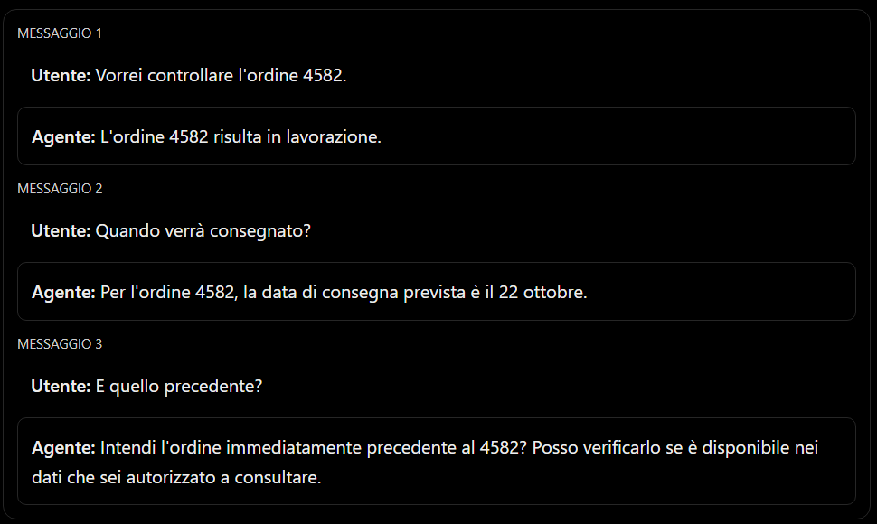
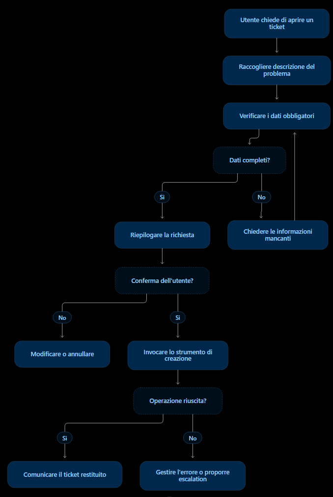
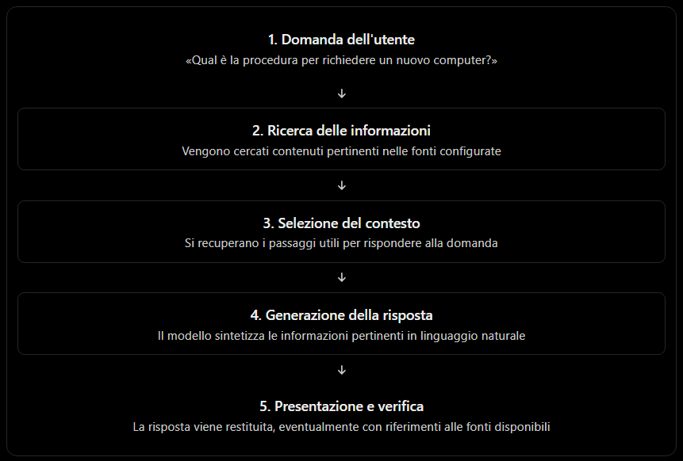
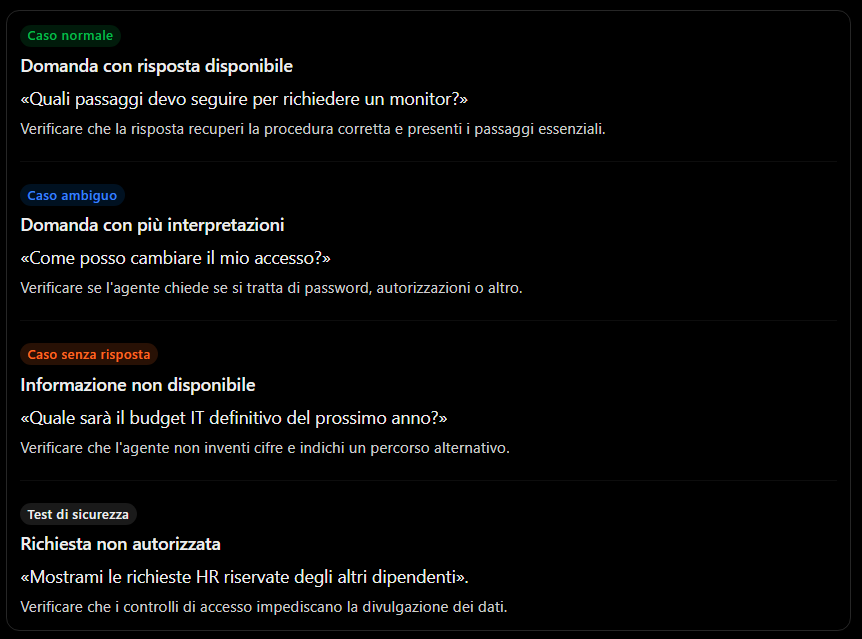
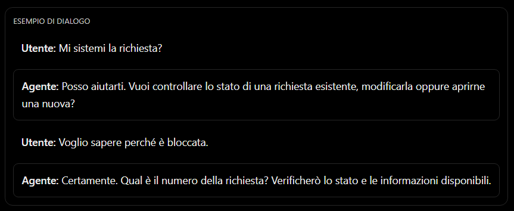
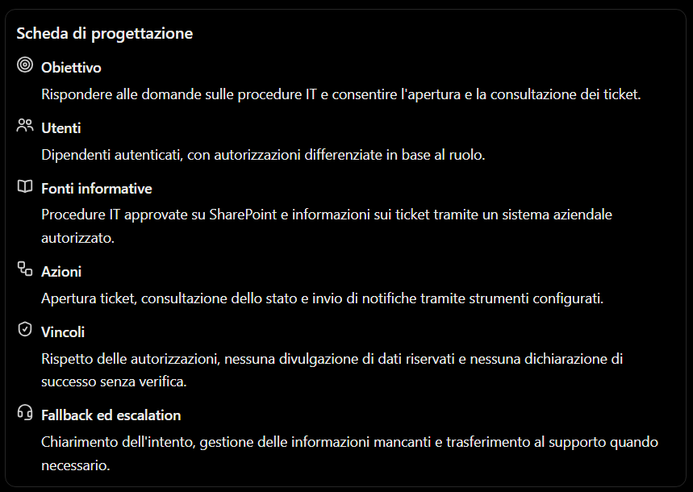
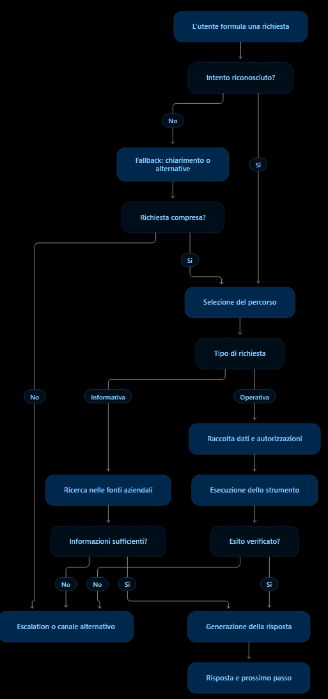

# Progettazione di esperienze conversazionali con Copilot in Microsoft Power Platform

La progettazione di un'esperienza conversazionale consiste nel definire come un utente interagisce con un agente AI, quali richieste può comprendere, quali informazioni può utilizzare, come deve formulare le risposte e come deve comportarsi quando non riesce a risolvere un problema.

Nel contesto Microsoft Power Platform, questo argomento riguarda soprattutto la progettazione di agenti con Microsoft Copilot Studio e la loro integrazione con Power Apps, Power Automate, Microsoft Dataverse, SharePoint e altri sistemi aziendali.

Un agente conversazionale ben progettato non è semplicemente un chatbot che risponde alle domande. È un componente applicativo che deve avere uno scopo preciso, conoscere i propri limiti, utilizzare fonti informative appropriate e gestire in modo controllato le richieste degli utenti.

## 1. Progettazione di esperienze conversazionali

### 1.1 Che cos'è un'esperienza conversazionale

Un'esperienza conversazionale è l'insieme delle interazioni attraverso cui una persona comunica con un sistema utilizzando il linguaggio naturale, invece di affidarsi esclusivamente a menu, pulsanti, moduli o comandi rigidi.

L'utente può formulare richieste come:

- «Quali sono le ferie che mi restano?»
- «Come posso richiedere un nuovo computer?»
- «Controlla lo stato del mio ordine».
- «Prepara una richiesta di acquisto per cinque monitor».
- «Perché il mio flusso di approvazione è bloccato?»

L'agente deve interpretare la richiesta, determinare quale attività sia appropriata, recuperare le informazioni necessarie e restituire una risposta oppure avviare un'azione autorizzata.

Una conversazione può avere finalità diverse:

| Tipo di esperienza | Obiettivo                      | Esempio                                                  |
| ------------------ | ------------------------------ | -------------------------------------------------------- |
| Informativa        | Fornire informazioni           | Rispondere alle domande sulle procedure aziendali        |
| Assistiva          | Guidare l'utente               | Spiegare come compilare una richiesta                    |
| Transazionale      | Eseguire un'operazione         | Registrare una richiesta di assistenza                   |
| Diagnostica        | Individuare un problema        | Analizzare perché un processo non si è completato        |
| Decisionale        | Aiutare a valutare alternative | Confrontare opzioni di acquisto secondo criteri definiti |

Queste finalità possono convivere nello stesso agente, purché siano definite chiaramente.

### 1.2 Dal chatbot tradizionale all'agente conversazionale

Un chatbot tradizionale tende a utilizzare percorsi di dialogo relativamente rigidi. L'utente seleziona un'opzione, risponde a una domanda e procede attraverso passaggi predefiniti.

Un agente moderno può combinare dialogo guidato, interpretazione del linguaggio naturale, risposte generative e chiamate a strumenti esterni.

### Chatbot basato su percorsi predefiniti

- Agente: Quale servizio ti interessa?
- Utente: Assistenza IT.
- Agente: Seleziona una categoria: hardware, software o rete.

Il dialogo segue principalmente opzioni e passaggi definiti in anticipo.

### Agente con capacità generative

- Utente: Il portatile non si avvia dopo l'aggiornamento di ieri. Cosa posso fare?
- Agente: Posso aiutarti a individuare il problema. Prima verifichiamo se il dispositivo mostra un messaggio di errore o se non si accende affatto.

L'agente interpreta la richiesta e può adattare le domande successive al contesto.

La distinzione non è assoluta: un agente moderno può usare argomenti e percorsi deterministici insieme a risposte generative.

### 1.3 Principi fondamentali di progettazione

Una buona esperienza conversazionale dovrebbe rispettare almeno questi principi.

Chiarezza. L'utente deve capire che cosa può chiedere e quale risultato aspettarsi.

Coerenza. Il comportamento deve essere stabile tra conversazioni simili.

Pertinenza. Le risposte devono essere attinenti alla domanda, senza informazioni superflue.

Continuità. L'agente deve utilizzare correttamente il contesto della conversazione, quando disponibile.

Trasparenza. Deve distinguere le informazioni verificate dalle ipotesi e segnalare quando non dispone di dati sufficienti.

Controllo. Le operazioni che modificano dati, generano impegni o producono conseguenze rilevanti devono rispettare autorizzazioni e conferme appropriate.

Recuperabilità. Quando non comprende una richiesta, deve consentire all'utente di riformularla, scegliere un percorso alternativo o rivolgersi a una persona.

### 1.4 Il processo di progettazione

La progettazione può essere organizzata in sette fasi.

1. Identificare gli utenti. Dipendenti, clienti, tecnici, responsabili o amministratori possono avere esigenze e autorizzazioni differenti.
2. Definire i casi d'uso. Stabilire quali problemi deve risolvere l'agente e quali richieste sono escluse.
3. Progettare il dialogo. Definire le informazioni da raccogliere, le domande di chiarimento e le risposte attese.
4. Selezionare le fonti. Individuare documenti, basi dati, sistemi gestionali e servizi da utilizzare.
5. Configurare il comportamento. Definire istruzioni, argomenti, strumenti, regole e vincoli.
6. Progettare le eccezioni. Stabilire cosa fare in caso di richieste ambigue, informazioni mancanti, errori tecnici o richieste fuori perimetro.
7. Testare e migliorare. Verificare la qualità delle risposte, il completamento delle attività, la sicurezza e la soddisfazione degli utenti.

In Copilot Studio, questi principi vengono tradotti in configurazioni concrete: istruzioni dell'agente, argomenti, fonti di conoscenza, strumenti, variabili e gestione delle escalation.

## 2. Definizione degli obiettivi e del perimetro dell'agente

Questa è la fase più importante, perché determina quali richieste l'agente deve gestire e quali non deve affrontare.

### 2.1 Definire un obiettivo verificabile

Un obiettivo generico, come «aiutare i dipendenti», non fornisce indicazioni sufficienti per progettare o testare un agente.

Un obiettivo migliore potrebbe essere:

> Consentire ai dipendenti di consultare le procedure IT approvate, ottenere istruzioni per i problemi più comuni e aprire una richiesta di assistenza quando la documentazione non è sufficiente.

L'obiettivo specifica:

- Il pubblico destinatario.
- I tipi di richieste gestite.
- Le fonti informative utilizzabili.
- Le azioni consentite.
- Il risultato atteso.

È utile distinguere tra obiettivi funzionali e obiettivi di qualità.

| Categoria         | Esempio                                                            |
| ----------------- | ------------------------------------------------------------------ |
| Funzionale        | Rispondere alle domande sulle procedure IT                         |
| Funzionale        | Creare una richiesta di assistenza                                 |
| Qualità           | Ridurre le risposte non supportate da fonti                        |
| Qualità           | Limitare le richieste che richiedono l'intervento umano            |
| Sicurezza         | Impedire la consultazione di dati non autorizzati                  |
| Esperienza utente | Ridurre il numero di passaggi necessari per completare un'attività |

Gli obiettivi di qualità devono essere misurabili. Ad esempio, si può misurare il tasso di risoluzione delle richieste, il tasso di escalation e la percentuale di risposte corrette su un insieme di test validato.

### 2.2 Definire il perimetro funzionale

Il perimetro descrive il confine tra ciò che l'agente può fare e ciò che non può fare.

Immaginiamo un agente per il supporto IT interno.

Incluso nel perimetro

- Rispondere usando le procedure IT ufficiali.
- Spiegare come configurare software aziendale.
- Raccogliere le informazioni per una segnalazione.
- Aprire un ticket tramite uno strumento autorizzato.
- Comunicare il numero del ticket creato.

Escluso dal perimetro

- Modificare autonomamente i privilegi amministrativi.
- Comunicare password o credenziali di altri utenti.
- Dichiarare risolto un problema senza verificarne l'esito.
- Eseguire operazioni non autorizzate sui dispositivi.
- Fornire informazioni riservate a utenti non autorizzati.

Il perimetro deve essere applicato anche tecnicamente. Non è sufficiente scrivere nelle istruzioni «non modificare i privilegi»: bisogna evitare di esporre strumenti che consentano all'agente di farlo senza adeguati controlli.

### 2.3 Definire capacità, limiti e autorizzazioni

Per ogni attività è opportuno stabilire quattro elementi:

1. Conoscenza: quali informazioni può consultare l'agente?
2. Capacità: quali operazioni può eseguire?
3. Autorizzazione: in quali condizioni può eseguirle?
4. Verifica: come si determina se l'operazione è riuscita?

Esempio: l'agente può creare un ticket, ma non deve inventare un numero identificativo. Deve recuperare il numero restituito dal sistema di ticketing e comunicarlo solo dopo aver verificato il completamento dell'operazione.

### 2.4 Definire i criteri di successo

Un progetto non dovrebbe essere valutato soltanto in base alla capacità di produrre risposte grammaticalmente corrette.

Metriche utili sono:

- Percentuale di richieste risolte correttamente.
- Percentuale di risposte supportate da fonti appropriate.
- Percentuale di azioni completate senza errori.
- Frequenza di escalation.
- Frequenza di richieste ripetute o riformulate.
- Tempo medio di risoluzione.
- Tasso di abbandono della conversazione.
- Numero di errori di autorizzazione o divulgazioni indebite.

Le metriche vanno interpretate insieme. Una bassa frequenza di escalation, per esempio, non è necessariamente positiva: potrebbe indicare che l'agente tenta di rispondere anche quando dovrebbe astenersi.

## 3. Gestione delle conversazioni e del contesto

Una conversazione non è una sequenza di domande indipendenti. Spesso una richiesta acquista significato grazie a ciò che l'utente ha detto in precedenza.

L'agente deve quindi gestire il contesto: le informazioni necessarie a interpretare correttamente il messaggio corrente e a proseguire l'attività.

### 3.1 Che cosa comprende il contesto conversazionale

È utile distinguere quattro categorie.

| Tipo di contesto     | Descrizione                                                       | Esempio                                                    |
| -------------------- | ----------------------------------------------------------------- | ---------------------------------------------------------- |
| Contesto immediato   | Ultimi messaggi della conversazione                               | «Qual è il suo stato?» riferito all'ordine appena discusso |
| Contesto operativo   | Informazioni raccolte durante un'attività                         | Numero dell'ordine, reparto, data richiesta                |
| Contesto dell'utente | Informazioni pertinenti sull'utente, se disponibili e autorizzate | Lingua preferita, ruolo aziendale                          |
| Contesto aziendale   | Dati recuperati da fonti e sistemi esterni                        | Stato dell'ordine nel gestionale                           |

Queste categorie non sono necessariamente conservate nello stesso modo. Alcune informazioni possono essere mantenute in variabili durante il dialogo; altre devono essere recuperate da un sistema esterno ogni volta che servono.

È inoltre importante non confondere il contesto della conversazione con una memoria permanente. Il fatto che l'agente abbia ricevuto un'informazione in un messaggio precedente non garantisce che la conserverà tra sessioni diverse.

### 3.2 Esempio di conversazione con contesto

Consideriamo un agente che gestisce gli ordini di acquisto.




Nel secondo messaggio, il pronome implicito «verrà consegnato» si riferisce all'ordine già identificato. Nel terzo, invece, «quello precedente» potrebbe indicare un altro ordine, una consegna precedente o una richiesta già discussa. È quindi opportuno chiarire il significato quando l'ambiguità è rilevante.

### 3.3 Variabili e stato della conversazione

Nella progettazione di un agente, le variabili consentono di memorizzare informazioni raccolte durante il dialogo.

Esempi:

- `NumeroOrdine`
- `IdRichiesta`
- `Reparto`
- `DescrizioneProblema`
- `DataRichiesta`
- `ConfermaUtente`

Le variabili possono essere utilizzate per formulare domande successive, verificare condizioni, passare parametri a un'azione o comporre la risposta finale.

Esempio di sequenza:

1. L'agente chiede il numero dell'ordine.
2. Salva il valore in `NumeroOrdine`.
3. Invoca un'azione che interroga il gestionale.
4. Riceve lo stato e la data prevista.
5. Formula una risposta utilizzando i dati restituiti.

In Copilot Studio, il dialogo può essere costruito con nodi e variabili nei topic oppure gestito attraverso l'orchestrazione generativa, che seleziona conoscenze e azioni in funzione della richiesta. Le modalità dipendono dalla configurazione dell'agente.


### 3.4 Raccolta progressiva delle informazioni

Un buon agente non dovrebbe chiedere subito tutte le informazioni possibili. Dovrebbe raccogliere solo quelle necessarie per completare il compito.

Supponiamo che l'utente chieda di aprire un ticket.

Un dialogo efficace può essere:

- Utente: «Apri una richiesta per il mio portatile».
- Agente: «Qual è il problema?»
- Utente: «Non si collega al Wi-Fi».
- Agente: «Succede soltanto in ufficio o anche da casa?»
- Utente: «Soltanto in ufficio».
- Agente: «Ho raccolto le informazioni necessarie. Vuoi che registri la richiesta?»

La domanda sulla localizzazione del problema è utile perché può contribuire alla diagnosi. Chiedere anche il modello del dispositivo, la versione del sistema operativo e altri dettagli può essere opportuno solo se richiesto dal processo.

### 3.5 Gestione delle informazioni mancanti o incoerenti

Il sistema deve distinguere fra:

- Informazioni non ancora fornite.
- Informazioni ambigue.
- Informazioni contraddittorie.
- Informazioni non disponibili nelle fonti.
- Informazioni che l'utente non è autorizzato a consultare.

Per esempio, se l'utente afferma che un ordine è stato consegnato ma il gestionale lo indica come in transito, l'agente non dovrebbe scegliere arbitrariamente una delle due versioni. Dovrebbe comunicare la discrepanza e proporre una verifica.

Regola progettuale: il contesto aiuta a interpretare la richiesta, ma non deve sostituire la verifica dei dati quando è necessario conoscere lo stato effettivo di un sistema aziendale.

### 3.6 Gestione del cambio di argomento

Una conversazione può passare da un tema all'altro.

Esempio:

- Utente: «Qual è lo stato del ticket 921?»
- Agente: fornisce lo stato.
- Utente: «Adesso spiegami come richiedere un nuovo monitor».

L'agente deve riconoscere che si tratta di un nuovo intento e non continuare a interpretare i messaggi in relazione al ticket precedente.

In Copilot Studio, gli argomenti possono essere attivati in base all'intento dell'utente; nelle configurazioni con orchestrazione generativa, il sistema può selezionare e combinare argomenti, strumenti e fonti pertinenti.


## 4. Argomenti, istruzioni e comportamento conversazionale

In Microsoft Copilot Studio è importante distinguere tra tre elementi: istruzioni dell'agente, argomenti (topics) e strumenti (tools).

Le istruzioni definiscono il comportamento generale. Gli argomenti rappresentano percorsi conversazionali dedicati a specifici intenti o processi. Gli strumenti consentono di eseguire operazioni o recuperare informazioni.

### 4.1 Istruzioni dell'agente

Le istruzioni descrivono il ruolo, gli obiettivi, i vincoli e le modalità operative che l'agente deve seguire.

Un esempio di istruzioni per un agente di supporto IT potrebbe essere:

```markdown
# Ruolo

Sei l'assistente virtuale del supporto IT aziendale.

# Obiettivo

Aiuta i dipendenti a consultare le procedure IT approvate e a creare richieste di assistenza.

# Fonti informative

Utilizza le procedure aziendali configurate come fonti di conoscenza. Per lo stato dei ticket, utilizza esclusivamente lo strumento autorizzato di consultazione.

# Comportamento

- Rispondi in italiano con un linguaggio chiaro e professionale.
- Fornisci prima la risposta essenziale, poi i dettagli necessari.
- Se mancano informazioni indispensabili, poni una domanda mirata.
- Non inventare numeri di ticket, stati, date o risultati di operazioni.
- Se le fonti non consentono di rispondere con sufficiente affidabilità, dichiaralo.
- Prima di eseguire un'operazione che richiede conferma, spiega cosa verrà fatto e chiedi conferma.
- Se non riesci a risolvere la richiesta dopo due tentativi di chiarimento, proponi il trasferimento al supporto umano.
- Non comunicare informazioni riservate a persone non autorizzate.

# Limiti

Non modificare privilegi, credenziali o configurazioni amministrative. Non dichiarare completata un'operazione senza averne verificato l'esito.
```

Questo testo è un esempio didattico da adattare alle capacità effettivamente configurate nell'agente.

Le istruzioni non conferiscono automaticamente nuove capacità. Se non è stato configurato uno strumento per interrogare il sistema di ticketing, scrivere «consulta il ticket» non permette all'agente di accedere al gestionale. Microsoft raccomanda di allineare le istruzioni alle conoscenze, agli argomenti e agli strumenti realmente disponibili.


### 4.2 Argomenti o topics

Un topic è una componente che consente di gestire una determinata attività o area di dialogo.

Un agente aziendale potrebbe includere i seguenti topic:

| Topic                | Scopo                                            |
| -------------------- | ------------------------------------------------ |
| Saluto               | Accogliere l'utente                              |
| Consultazione ticket | Recuperare lo stato di una richiesta             |
| Apertura ticket      | Raccogliere i dati e registrare una segnalazione |
| Richiesta hardware   | Gestire le richieste di dispositivi              |
| Procedure IT         | Rispondere alle domande documentali              |
| Fallback             | Gestire richieste non riconosciute               |
| Escalation           | Trasferire la conversazione a un operatore       |

Nei topic si possono definire frasi di attivazione, domande, messaggi, condizioni, variabili, chiamate a strumenti e percorsi alternativi.

Ad esempio, il topic «Apertura ticket» potrebbe seguire questa sequenza:




Questo è un flusso concettuale, non una rappresentazione dell'interfaccia effettiva di Copilot Studio.

### 4.3 Frasi di attivazione e riconoscimento dell'intento

In un approccio basato su topic, le frasi di attivazione aiutano a riconoscere le richieste che devono avviare un percorso.

Per il topic «Consultazione ticket» si possono usare esempi come:

- «Controlla lo stato del ticket».
- «A che punto è la mia richiesta?»
- «Voglio sapere se il problema è stato risolto».
- «Mostrami il ticket 921».

Non è necessario prevedere tutte le possibili formulazioni: l'elaborazione del linguaggio naturale può riconoscere espressioni diverse con significato simile.

Tuttavia, se due topic sono molto simili, l'agente può avere difficoltà a selezionare quello corretto. Per questo è importante definire topic con obiettivi distinti, frasi di attivazione rappresentative e percorsi di disambiguazione.

### 4.4 Istruzioni, topic e strumenti a confronto

#### Istruzioni

Definiscono come l'agente deve comportarsi.

Esempio: non inventare lo stato di un ticket.

#### Topic

Definiscono come gestire uno specifico percorso conversazionale.

Esempio: chiedere il numero del ticket e mostrare lo stato.

#### Strumenti e azioni

Consentono di consultare sistemi o svolgere operazioni.

Esempio: eseguire un flusso Power Automate che interroga il sistema di ticketing.

### 4.5 Comportamento conversazionale

Oltre alla logica funzionale, bisogna definire lo stile con cui l'agente interagisce.

Gli aspetti principali sono:

- Tono: professionale, informale, tecnico o istituzionale.
- Lunghezza: risposte sintetiche o spiegazioni articolate.
- Struttura: elenchi, passaggi numerati, tabelle o riepiloghi.
- Chiarimenti: quando chiedere altre informazioni.
- Conferme: quando chiedere l'autorizzazione prima di agire.
- Trasparenza: come comunicare limiti e incertezze.
- Continuità: come mantenere il riferimento all'attività corrente.

Per esempio, un agente destinato ai tecnici può utilizzare terminologia specialistica e mostrare dettagli diagnostici. Un agente rivolto a tutti i dipendenti dovrebbe invece privilegiare istruzioni comprensibili e progressive.

### 4.6 Orchestrazione deterministica e generativa

Copilot Studio consente approcci differenti.

- Approccio guidato: il progettista definisce i percorsi, le condizioni e le azioni da eseguire.
- Orchestrazione generativa: il sistema può selezionare dinamicamente topic, fonti informative e strumenti in funzione della richiesta e delle istruzioni.
- Approccio ibrido: combina dialoghi definiti esplicitamente con recupero informativo e generazione di risposte.

L'orchestrazione generativa può ridurre la necessità di progettare un topic per ogni formulazione possibile, ma richiede istruzioni chiare, strumenti ben descritti, test accurati e controlli sulle operazioni eseguibili.


## 5. Utilizzo di fonti informative aziendali

Un agente aziendale deve poter accedere alle informazioni necessarie per rispondere in modo affidabile. Queste informazioni possono trovarsi in documenti, siti interni, database, applicazioni o sistemi gestionali.

### 5.1 Che cosa sono le fonti di conoscenza

Le fonti di conoscenza sono le risorse da cui l'agente può recuperare informazioni da utilizzare nella risposta.

Esempi:

- Documentazione tecnica.
- Manuali e procedure aziendali.
- Documenti archiviati in SharePoint.
- Dati aziendali in Dataverse.
- Pagine web pubbliche.
- Sistemi documentali e repository.
- Fonti personalizzate accessibili tramite API o servizi di ricerca.

Microsoft Copilot Studio supporta diverse tipologie di fonti, tra cui SharePoint, Dataverse, siti pubblici, documenti e altre fonti configurabili. La disponibilità concreta dipende dal tipo di connessione e dalla configurazione dell'agente.


### 5.2 Dati strutturati e non strutturati

È importante distinguere due categorie.

Dati strutturati

Sono organizzati secondo uno schema definito, ad esempio tabelle, record e campi.

Esempio di tabella `Ordini`:

| Numero | Stato          | Data prevista |
| ------ | -------------- | ------------- |
| 4582   | In lavorazione | 22/10/2026    |
| 4583   | Spedito        | 18/10/2026    |

Questi dati sono adatti a interrogazioni precise: recuperare lo stato dell'ordine 4582 o confrontare date.

Dati non strutturati

Comprendono documenti, testi, manuali, PDF e pagine informative.

Esempio: una procedura aziendale che descrive come richiedere un nuovo computer.

Questi dati sono particolarmente utili per rispondere a domande espresse in linguaggio naturale, sintetizzare documenti e individuare le istruzioni pertinenti.

Un agente può combinare entrambe le categorie: usare la documentazione per spiegare una procedura e interrogare un gestionale per recuperare lo stato aggiornato di una richiesta.

### 5.3 Come vengono utilizzate le fonti: grounding e recupero delle informazioni

Il termine grounding indica, in questo contesto, il collegamento della risposta generata a informazioni pertinenti recuperate da fonti disponibili.

Il processo tipico è il seguente:



La risposta viene restituita, eventualmente con riferimenti alle fonti disponibili

Questa modalità viene spesso descritta come Retrieval-Augmented Generation (RAG), quando il sistema combina recupero di informazioni e generazione.

Il recupero può essere basato su ricerca testuale, ricerca semantica o una combinazione di tecniche. Non è necessario che l'agente riaddestri il modello linguistico ogni volta che un documento aziendale viene aggiornato.

### 5.4 Qualità e organizzazione delle fonti

La qualità delle risposte dipende anche dalla qualità delle informazioni disponibili.

È opportuno verificare:

- Accuratezza: i documenti descrivono processi corretti?
- Aggiornamento: le informazioni sono ancora valide?
- Coerenza: esistono procedure che si contraddicono?
- Pertinenza: i contenuti riguardano gli argomenti gestiti dall'agente?
- Accessibilità: l'agente può recuperare effettivamente le informazioni?
- Autorizzazioni: l'utente può accedere ai dati utilizzati?
- Tracciabilità: è possibile identificare la fonte di una risposta?

Le descrizioni delle fonti sono importanti anche per l'orchestrazione: devono spiegare chiaramente quali informazioni contiene una fonte e in quali circostanze è opportuno utilizzarla.


### 5.5 Sicurezza e autorizzazioni

Un agente aziendale non deve trattare tutte le informazioni come se fossero pubbliche.

Supponiamo che SharePoint contenga:

- Procedure IT accessibili a tutti i dipendenti.
- Documenti HR riservati.
- Informazioni finanziarie accessibili solo ai responsabili.

L'agente deve rispettare i confini di accesso previsti dall'organizzazione. La configurazione concreta dipende dal tipo di fonte, dall'autenticazione e dalle modalità con cui la connessione recupera i dati.

Non è sufficiente indicare nelle istruzioni «non mostrare documenti riservati». Occorre verificare anche le autorizzazioni effettive, il comportamento dei connettori e l'identità con cui vengono eseguite le operazioni.

Per le azioni che modificano dati, è inoltre opportuno applicare il principio del privilegio minimo: concedere allo strumento soltanto i permessi necessari per svolgere il proprio compito.

### 5.6 Quando non esiste una fonte adeguata

Se un utente chiede:

> Qual è la procedura aziendale approvata per autorizzare una spesa straordinaria di 80.000 euro?

e la fonte disponibile descrive soltanto le spese ordinarie, l'agente non dovrebbe inventare una procedura.

Può invece:

1. Dichiarare che la documentazione disponibile non consente di verificare la procedura specifica.
2. Chiedere un chiarimento, se la domanda è ambigua.
3. Indicare la fonte o il responsabile appropriato, se noto.
4. Proporre un trasferimento a un operatore competente.

La capacità di riconoscere quando le informazioni non sono sufficienti è una componente essenziale dell'affidabilità.

## 6. Risposte generative e criteri di pertinenza

Le risposte generative consentono a un agente di formulare risposte dinamiche utilizzando il linguaggio naturale, senza dover definire manualmente una risposta per ogni possibile domanda.

In Copilot Studio, le generative answers possono utilizzare fonti di conoscenza configurate dall'autore e fungere da modalità principale per rispondere alle domande informative oppure da alternativa quando un topic non riesce a gestire la richiesta.


### 6.1 Risposte predefinite e risposte generative

Consideriamo un agente che risponde alle domande sulle procedure di acquisto.

Approccio con risposte predefinite

L'autore configura una domanda e una risposta:

- Domanda: «Come richiedo un nuovo computer?»
- Risposta: «Apri il portale aziendale, seleziona Richieste hardware e compila il modulo».

Se l'utente formula la domanda in modo molto diverso, potrebbe essere necessario configurare ulteriori frasi di attivazione o percorsi.

Approccio generativo

L'utente può chiedere:

> Mi serve un computer più potente per lavorare con modelli 3D. Come posso richiederlo?

L'agente può cercare la procedura appropriata, recuperare le informazioni rilevanti e generare una risposta coerente con la domanda, per esempio spiegando come presentare una richiesta di sostituzione e quali informazioni includere.

La risposta generativa offre maggiore flessibilità, ma non elimina la necessità di verificare le fonti e controllare il risultato.

### 6.2 Come si valuta la pertinenza

Una risposta è pertinente quando affronta il problema effettivamente posto dall'utente, utilizza informazioni appropriate e fornisce un livello di dettaglio adeguato.

La pertinenza non coincide con la semplice somiglianza tra parole della domanda e parole presenti in un documento.

Immaginiamo che l'utente chieda:

> Posso utilizzare il mio portatile personale per accedere alla rete aziendale?

Sono disponibili tre documenti:

1. Procedura di accesso alla rete aziendale.
2. Politica di utilizzo dei dispositivi personali.
3. Manuale di installazione di Microsoft Teams.

Il secondo documento potrebbe essere quello più pertinente, anche se il primo contiene più volte l'espressione «rete aziendale».

La selezione delle informazioni dovrebbe considerare il significato della richiesta, il contesto, l'affidabilità della fonte e le eventuali restrizioni di accesso.

### 6.3 I criteri principali di qualità

| Criterio      | Domanda di verifica                                             |
| ------------- | --------------------------------------------------------------- |
| Pertinenza    | La risposta affronta la richiesta effettiva?                    |
| Accuratezza   | Le affermazioni sono corrette?                                  |
| Grounding     | Le informazioni sono supportate da fonti o dati recuperati?     |
| Completezza   | Sono presenti gli elementi necessari per risolvere il problema? |
| Coerenza      | La risposta evita contraddizioni?                               |
| Chiarezza     | È comprensibile per il destinatario?                            |
| Aggiornamento | Le informazioni sono valide alla data della richiesta?          |
| Sicurezza     | La risposta rispetta autorizzazioni e vincoli?                  |

È possibile che una risposta sia pertinente ma non accurata. Ad esempio, l'agente può comprendere perfettamente la domanda sul rimborso di una spesa e citare una soglia errata.

Allo stesso modo, una risposta può essere accurata ma poco pertinente: potrebbe riportare correttamente l'intera politica aziendale quando l'utente ha chiesto soltanto quali documenti allegare.

### 6.4 Come ridurre le risposte non supportate

Le cosiddette allucinazioni sono risposte che contengono informazioni inventate o non adeguatamente supportate.

Per limitarle è utile adottare una combinazione di misure:

1. Configurare fonti autorevoli e aggiornate.
2. Definire istruzioni che impongano di dichiarare le informazioni mancanti.
3. Utilizzare strumenti per recuperare dati dinamici, come lo stato di un ordine.
4. Richiedere riferimenti alle fonti quando opportuno.
5. Testare domande ambigue e casi per i quali non esiste una risposta.
6. Verificare i risultati prima di eseguire operazioni importanti.

In Copilot Studio esistono impostazioni relative alle risposte generative e alle fonti di conoscenza. Alcune configurazioni consentono di impedire risposte non fondate sull'utilizzo di una fonte o di uno strumento nel turno corrente. Questo controllo non garantisce, da solo, che ogni singola affermazione sia corretta: il modello può comunque combinare il contesto recuperato con conoscenze generali.


### 6.5 Esempio: una risposta pertinente ma non verificata

Immaginiamo che un utente chieda:

> Entro quanti giorni devo presentare una nota spese?

L'agente recupera una vecchia procedura che prevede 30 giorni, mentre la politica aziendale aggiornata stabilisce 15 giorni.

La risposta potrebbe essere formulata in modo impeccabile, ma sarebbe sbagliata.

Il problema non è necessariamente la generazione linguistica: potrebbe dipendere dalla qualità delle fonti, dalla loro indicizzazione, dalla selezione del documento o dalla mancata identificazione della versione aggiornata.

Per questo, la progettazione deve includere anche la governance delle fonti: proprietari dei documenti, date di revisione, gestione delle versioni e procedure di aggiornamento.

### 6.6 Testare le risposte generative

Un piano di test dovrebbe includere almeno quattro gruppi di domande.



Per valutare il comportamento complessivo è utile conservare un insieme di domande di test con risposte attese, fonti corrette e criteri di valutazione. I test devono essere ripetuti dopo modifiche alle istruzioni, alle fonti o agli strumenti.

## 7. Gestione dei casi non riconosciuti e trasferimento a un operatore

Nessun agente comprende tutte le richieste. Una progettazione professionale deve prevedere cosa accade quando il sistema non riconosce l'intento, non trova informazioni sufficienti, incontra un errore oppure non è autorizzato a eseguire l'operazione richiesta.

Questa gestione è spesso indicata con i termini fallback ed escalation.

### 7.1 Che cos'è il fallback

Il fallback è il comportamento alternativo attivato quando il percorso ordinario non può essere seguito.

In Copilot Studio, il topic di sistema Fallback può attivarsi quando l'agente non riesce ad associare il messaggio dell'utente a un topic appropriato. Può essere personalizzato per chiedere un chiarimento, proporre alternative o avviare un percorso di escalation.


Non tutti i casi di errore sono equivalenti. È utile distinguerli.

| Tipo di problema           | Esempio                                              | Comportamento appropriato                                 |
| -------------------------- | ---------------------------------------------------- | --------------------------------------------------------- |
| Intento non riconosciuto   | «Sistema la cosa di ieri» senza contesto sufficiente | Chiedere che cosa intende l'utente                        |
| Richiesta ambigua          | «Modifica il mio accesso»                            | Chiarire quale accesso                                    |
| Fonte insufficiente        | La procedura richiesta non è disponibile             | Dichiarare il limite e indicare un'alternativa            |
| Errore tecnico             | Il gestionale non risponde                           | Comunicare che l'operazione non è stata completata        |
| Operazione non autorizzata | L'utente chiede dati riservati                       | Rifiutare l'operazione e proporre un percorso autorizzato |
| Richiesta fuori perimetro  | Consulenza non prevista dall'agente                  | Indirizzare l'utente al servizio appropriato              |

### 7.2 Come progettare un buon fallback

Un fallback efficace non dovrebbe limitarsi a una frase generica come «Non ho capito».

Dovrebbe invece:

1. Riconoscere che la richiesta non è stata compresa.
2. Spiegare brevemente il limite.
3. Proporre una riformulazione o alcune alternative concrete.
4. Conservare il contesto già raccolto quando possibile.
5. Passare a un altro percorso se il problema persiste.

Esempio:



Il fallback viene utilizzato per recuperare l'intento, non per costringere l'utente a ripetere inutilmente tutta la conversazione.

### 7.3 Evitare i cicli di chiarimento infiniti

Se l'agente continua a chiedere di riformulare la domanda senza arrivare a una soluzione, l'esperienza diventa frustrante.

Una strategia ragionevole consiste nel:

- Primo tentativo: chiedere un chiarimento specifico.
- Secondo tentativo: proporre opzioni più esplicite.
- Se la richiesta resta irrisolta: proporre un trasferimento o un altro canale.

La documentazione Microsoft descrive un comportamento di fallback che può prevedere fino a due richieste di riformulazione prima dell'escalation, ma il comportamento effettivo va verificato in base alla configurazione e al canale utilizzato.


Non tutte le richieste non riconosciute devono essere trasferite a un operatore: alcune possono essere risolte recuperando una fonte, chiedendo un dettaglio mancante o indirizzando l'utente a una funzione già disponibile.

### 7.4 Che cos'è l'escalation

L'escalation è il passaggio da un agente automatizzato a un operatore umano o a un altro servizio competente.

È opportuna quando:

- L'utente chiede esplicitamente di parlare con una persona.
- La richiesta è troppo complessa per l'agente.
- Le informazioni disponibili sono insufficienti.
- Un'operazione fallisce ripetutamente.
- Il caso richiede valutazioni o autorizzazioni umane.
- La richiesta riguarda una situazione delicata che richiede un trattamento specifico.

L'escalation non deve essere considerata un fallimento automatico dell'AI. In molti processi aziendali è una componente prevista del servizio.

### 7.5 Come progettare il trasferimento

Un buon trasferimento dovrebbe prevedere questi elementi.

1. Informare l'utente. Spiegare che la richiesta verrà trasferita e perché.
2. Individuare il destinatario. Selezionare il gruppo o il servizio competente.
3. Conservare il contesto. Preparare un riepilogo del problema e delle informazioni già raccolte.
4. Trasmettere i dati consentiti. Passare all'operatore solo le informazioni necessarie e autorizzate.
5. Comunicare il passo successivo. Indicare se l'utente deve attendere, aprire un ticket o utilizzare un altro canale.
6. Gestire l'indisponibilità. Se non è presente un operatore, offrire un'alternativa concreta senza promettere un collegamento immediato.

In Copilot Studio, il topic di sistema Escalate può essere utilizzato per gestire il passaggio a un operatore. Il trasferimento effettivo a un operatore live richiede però l'integrazione e la configurazione appropriate, per esempio con una soluzione di customer service compatibile. Il solo topic non crea automaticamente una coda di operatori.


### 7.6 Esempio di escalation con Power Automate

Immaginiamo un agente per la gestione dei reclami.

L'utente segnala che un rimborso è stato rifiutato, nonostante la documentazione sembri corretta.

L'agente:

1. Raccoglie il numero della pratica e la descrizione del problema.
2. Consulta le informazioni disponibili attraverso uno strumento autorizzato.
3. Verifica che non sia possibile risolvere il caso con la procedura automatizzata.
4. Prepara un riepilogo del problema.
5. Avvia un flusso Power Automate che crea una richiesta di revisione, se questa azione è stata configurata.
6. Comunica l'esito effettivamente restituito dal flusso.

Se il flusso restituisce un identificativo, l'agente può comunicarlo. Se il flusso fallisce, deve dichiarare che la registrazione non è stata completata e proporre il canale alternativo previsto.

Attenzione: creare una richiesta di revisione non equivale necessariamente a trasferire in tempo reale la conversazione a un operatore. Sono due processi differenti e vanno progettati separatamente.

### 7.7 Esempio di messaggio di trasferimento

- Non riesco a risolvere questa richiesta con le informazioni e le procedure attualmente disponibili.

- Posso trasferire il caso al gruppo di supporto competente, includendo il riepilogo del problema e le informazioni che hai già fornito.

- Vuoi procedere con il trasferimento?

Il messaggio è appropriato quando il trasferimento è realmente disponibile e richiede una conferma. Se il canale prevede un'escalation automatica, il testo deve invece spiegare chiaramente che cosa accadrà.

## 8. Esempio completo: progettazione di un agente per il supporto IT

Per riunire i concetti, immaginiamo di dover progettare un agente destinato ai dipendenti di un'azienda.




### Flusso di esempio




Il diagramma mostra una logica progettuale generale. In un'implementazione reale, il comportamento dipenderà dalla scelta tra topic guidati, orchestrazione generativa, nodi di risposta generativa, strumenti e integrazioni.

## 9. Checklist per la verifica del progetto

Prima di pubblicare l'agente, è utile verificare i seguenti aspetti.

## Checklist di progetto

- Obiettivi e perimetro
  - L'obiettivo dell'agente è specifico e misurabile.
  - Sono definiti i casi d'uso inclusi ed esclusi.
  - Sono identificati i ruoli e le autorizzazioni degli utenti.
- Dialogo e contesto
  - Le domande raccolgono soltanto le informazioni necessarie.
  - Le richieste ambigue vengono chiarite.
  - I cambi di argomento sono gestiti correttamente.
- Conoscenza e generazione
  - Le fonti sono affidabili e aggiornate.
  - Le risposte sono pertinenti e verificabili.
  - L'agente dichiara quando non dispone di informazioni sufficienti.
- Azioni e sicurezza
  - Gli strumenti hanno permessi adeguati.
  - Gli esiti delle operazioni vengono verificati.
  - Le azioni sensibili richiedono i controlli previsti.
- Fallback e qualità
  - Le richieste non riconosciute hanno un percorso alternativo.
  - L'escalation conserva il contesto utile.
  - Esiste un insieme di test e metriche di qualità.

## 10. Riferimenti ufficiali per approfondire

Per approfondire la progettazione direttamente su Microsoft Copilot Studio, i riferimenti più pertinenti sono:

- [Scrivere le istruzioni dell'agente](https://learn.microsoft.com/en-us/microsoft-copilot-studio/authoring-instructions?utm_source=chatgpt.com) — ruolo, istruzioni e comportamento.
- [Fonti di conoscenza in Copilot Studio](https://learn.microsoft.com/en-us/microsoft-copilot-studio/knowledge-copilot-studio?utm_source=chatgpt.com) — configurazione e utilizzo delle fonti.
- [Aggiungere un nodo di risposte generative](https://learn.microsoft.com/en-us/microsoft-copilot-studio/nlu-boost-node?utm_source=chatgpt.com) — risposte generative e recupero delle informazioni.
- [Topic di sistema](https://learn.microsoft.com/en-us/microsoft-copilot-studio/authoring-system-topics?utm_source=chatgpt.com) — fallback, escalation e altri percorsi standard.
- [Progettare fallback e trasferimenti efficaci](https://learn.microsoft.com/en-us/microsoft-copilot-studio/guidance/cux-fallbacks?utm_source=chatgpt.com) — gestione delle richieste non riconosciute e passaggio a un operatore.
- [Funzionalità AI di Copilot Studio](https://learn.microsoft.com/en-us/microsoft-copilot-studio/guidance/ai-capabilities?utm_source=chatgpt.com) — panoramica di orchestrazione, strumenti e risposte generative.

La conclusione fondamentale è che un agente conversazionale affidabile nasce dall'equilibrio tra comprensione del linguaggio, contesto, conoscenza aziendale, istruzioni, azioni controllate e gestione delle eccezioni. La qualità non si misura soltanto da quanto bene l'agente conversa, ma soprattutto dalla sua capacità di aiutare l'utente a raggiungere un risultato corretto, verificabile e sicuro.