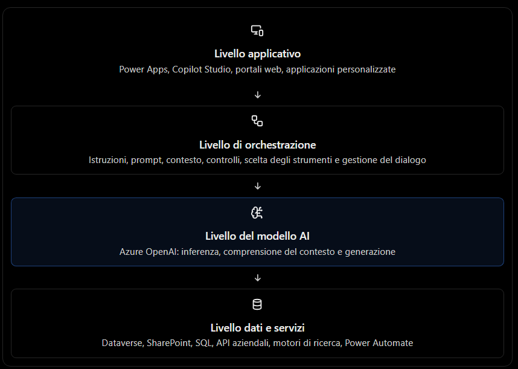
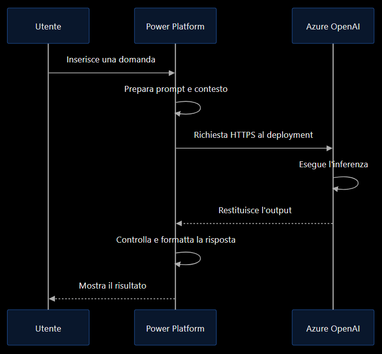
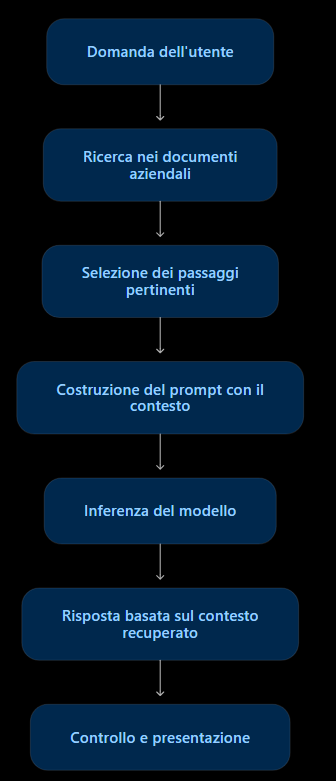
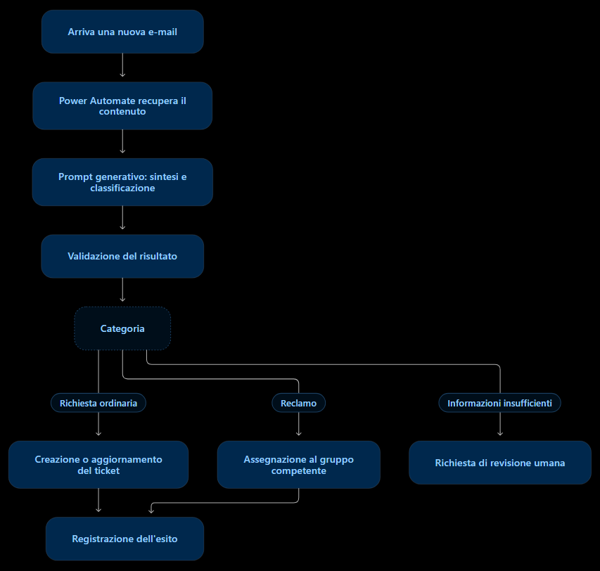

# Azure OpenAI e modelli generativi: architettura, inferenza e integrazione con Power Platform

Nel contesto Microsoft Azure e Power Platform, i modelli generativi rappresentano il componente che permette alle applicazioni di comprendere richieste in linguaggio naturale, produrre testi, sintetizzare documenti, estrarre informazioni e supportare processi aziendali.

Per comprendere come utilizzare queste tecnologie, è importante distinguere il modello AI dal servizio che lo rende disponibile, dall'endpoint attraverso cui viene invocato e dall'applicazione che utilizza i risultati.

Il collegamento con Microsoft Power Platform può avvenire attraverso diversi meccanismi: connettori, Power Automate, Power Apps, Copilot Studio, AI Builder e chiamate a servizi Azure tramite API.

## 1. Ruolo dei modelli linguistici nell'architettura AI

### 1.1 Che cos'è un modello linguistico

Un Large Language Model (LLM) è un modello di intelligenza artificiale addestrato su grandi quantità di dati per apprendere le relazioni tra parole, sequenze e altri elementi del linguaggio.

Durante l'addestramento, il modello apprende rappresentazioni statistiche e strutturali che gli permettono di elaborare richieste e generare sequenze coerenti con il contesto ricevuto.

I modelli linguistici possono essere utilizzati per:

- Comprendere domande formulate in linguaggio naturale.
- Generare testi, spiegazioni e risposte.
- Riassumere documenti e conversazioni.
- Tradurre contenuti.
- Estrarre informazioni da testi non strutturati.
- Generare codice e spiegare codice esistente.
- Classificare contenuti attraverso istruzioni in linguaggio naturale.
- Selezionare o invocare strumenti, se il modello e l'applicazione supportano questa funzionalità.

Un punto fondamentale è che un LLM non è automaticamente un database, un motore di ricerca o un sistema transazionale. Le sue capacità di generazione non gli conferiscono, da sole, accesso ai dati aziendali aggiornati o la possibilità di eseguire operazioni su sistemi esterni.

### 1.2 Il ruolo del modello nell'architettura

In una soluzione aziendale, il modello linguistico è normalmente uno dei componenti di un'architettura più ampia.



Questo schema è concettuale: alcuni componenti possono interagire direttamente e non tutte le soluzioni richiedono tutti i livelli.

È particolarmente importante distinguere il livello del modello da quello dei dati. Un modello può generare una risposta senza consultare fonti esterne, ma per rispondere correttamente a una domanda come «Qual è lo stato attuale dell'ordine 4582?» è normalmente necessario interrogare il sistema aziendale che contiene lo stato effettivo dell'ordine.

### 1.3 Il modello non coincide con l'applicazione AI

Consideriamo un assistente aziendale che risponde alle domande sulle procedure HR.

Il modello linguistico può interpretare la domanda e formulare la risposta, ma l'applicazione deve anche:

1. Autenticare l'utente.
2. Determinare quali documenti può consultare.
3. Recuperare i passaggi pertinenti dalle fonti HR.
4. Inserire le informazioni nel contesto del modello.
5. Generare la risposta.
6. Eventualmente citare le fonti.
7. Registrare le informazioni operative necessarie e gestire gli errori.

Il modello è quindi il motore generativo, mentre l'applicazione ne governa l'utilizzo.

### 1.4 Modelli generalisti e modelli specializzati

Non tutti i modelli AI sono progettati per svolgere gli stessi compiti.

Un modello linguistico generalista può essere adatto a riassunti, spiegazioni, conversazioni e generazione di contenuti.

Un modello specializzato può essere progettato o ottimizzato per:

- Riconoscimento vocale.
- Sintesi vocale.
- Analisi delle immagini.
- Estrazione di testo da documenti.
- Classificazione di contenuti.
- Previsioni numeriche.

La scelta deve dipendere dal tipo di problema, dalla precisione richiesta, dai tempi di risposta, dal costo e dai vincoli di sicurezza.

## 2. Endpoint, deployment del modello e inferenza

Questi tre concetti sono essenziali per comprendere come un modello viene utilizzato in Azure OpenAI.

### 2.1 Modello

Il modello è il sistema AI addestrato che esegue il compito.

La famiglia di modelli determina le capacità disponibili, ad esempio generazione testuale, ragionamento, elaborazione multimodale o generazione di codice.

Ogni modello può avere caratteristiche differenti in termini di:

- Capacità e qualità delle risposte.
- Finestra di contesto.
- Modalità di input e output.
- Latenza.
- Costo.
- Disponibilità delle funzionalità API.

Il nome del modello identifica una determinata famiglia o versione, non necessariamente una risorsa Azure già configurata per essere invocata.

### 2.2 Deployment

Il deployment è la configurazione con cui un modello viene reso disponibile per l'utilizzo in un ambiente Azure AI.

Nel servizio Azure OpenAI, si crea o si configura una risorsa compatibile, si seleziona un modello disponibile e si effettua il deployment secondo le opzioni offerte dalla piattaforma.

Il deployment è identificato da un nome che viene utilizzato nelle richieste API. Questo nome può essere diverso dal nome del modello sottostante.

Per esempio:

| Elemento               | Esempio                               |
| ---------------------- | ------------------------------------- |
| Servizio               | Azure OpenAI                          |
| Risorsa Azure          | `aoai-azienda-dev`                    |
| Modello selezionato    | Un modello linguistico supportato     |
| Nome del deployment    | `chat-hr-dev`                         |
| Applicazione chiamante | Power Automate o un'applicazione .NET |

I nomi sono illustrativi.

Il deployment non significa necessariamente che l'organizzazione stia installando il modello su una macchina virtuale propria: il servizio gestisce l'infrastruttura secondo il tipo di deployment e le condizioni del servizio scelto.

### 2.3 Endpoint

L'endpoint è l'indirizzo attraverso il quale un'applicazione raggiunge il servizio.

Una risorsa Azure OpenAI dispone di un endpoint, normalmente basato su HTTPS. L'applicazione invia una richiesta HTTP contenente i dati di input e le opzioni supportate dall'API.

L'endpoint e il deployment sono concetti distinti:

- Endpoint: identifica il punto di accesso al servizio.
- Deployment: identifica il modello distribuito da utilizzare nella richiesta.
- API: definisce il formato della richiesta e della risposta.

A seconda dell'API e della versione utilizzata, il deployment può essere indicato nel percorso della richiesta oppure selezionato tramite il parametro previsto dall'interfaccia API.

### 2.4 Inferenza

L'inferenza è l'esecuzione del modello su un input per produrre un risultato.

Durante l'inferenza, il modello utilizza i parametri appresi durante l'addestramento e il contesto fornito dall'applicazione per generare un output.

Un esempio semplificato:

1. L'utente inserisce una domanda.
2. Power Automate o un'applicazione prepara la richiesta.
3. La richiesta viene inviata al deployment Azure OpenAI.
4. Il modello elabora l'input.
5. Il servizio restituisce la risposta.
6. L'applicazione utilizza il risultato, ad esempio mostrandolo in Power Apps o inviandolo via e-mail.

L'inferenza non coincide con l'addestramento: normalmente, durante una richiesta applicativa, il modello non viene riaddestrato sui dati inviati.

### 2.5 Il flusso completo di una richiesta




Questo flusso può essere esteso con ricerca documentale, chiamate a API aziendali, controlli di autorizzazione e validazione dell'output.

### 2.6 Autenticazione, quote e disponibilità

Per utilizzare un endpoint occorre anche configurare correttamente l'accesso.

A seconda dell'architettura, possono essere utilizzati:

- Chiavi API.
- Microsoft Entra ID e identità gestite, quando supportate dal percorso d'integrazione.
- Autorizzazioni RBAC.
- Reti virtuali, endpoint privati e controlli di rete.

Le credenziali non devono essere inserite direttamente nel codice client o esposte all'utente finale. Quando possibile, è preferibile utilizzare identità e meccanismi di autenticazione gestiti.

È inoltre necessario considerare quote, limiti di richieste, capacità del deployment, latenza e gestione degli errori. Un'applicazione robusta deve saper gestire risposte di errore, limiti di traffico e tentativi ripetuti senza generare richieste incontrollate.

## 3. Parametri di generazione e gestione del contesto

Quando si invia una richiesta a un modello generativo, non si trasmette necessariamente soltanto una domanda. La richiesta può contenere istruzioni, messaggi precedenti, documenti recuperati, parametri di generazione e indicazioni sul formato della risposta.

Questi elementi influenzano il comportamento del modello e il risultato restituito.

### 3.1 Struttura di un prompt

Un prompt è l'input utilizzato per guidare il modello verso il risultato desiderato.

In un'applicazione conversazionale, può comprendere:

- Istruzioni di sistema: definiscono ruolo, vincoli e comportamento.
- Messaggio dell'utente: contiene la richiesta corrente.
- Contesto conversazionale: comprende i messaggi precedenti rilevanti.
- Contesto informativo: contiene dati recuperati da documenti o sistemi.
- Parametri di generazione: regolano lunghezza, variabilità e altri aspetti dell'output.

Esempio di prompt per un assistente HR:

---

#### Istruzioni

Sei un assistente HR aziendale. Rispondi in italiano usando un tono professionale. Non inventare informazioni sulle politiche aziendali.

#### Contesto documentale

La procedura aziendale specifica che le richieste di ferie devono essere presentate attraverso il portale HR e approvate dal responsabile.

#### Richiesta dell'utente

Come posso richiedere tre giorni di ferie?

#### Compito

Spiega i passaggi necessari usando esclusivamente le informazioni disponibili nel contesto. Se manca un dettaglio, dichiaralo.

---

Il modello riceve istruzioni e informazioni che lo aiutano a produrre una risposta pertinente. Il prompt, però, non costituisce da solo un sistema di autorizzazione: i permessi devono essere applicati anche dall'applicazione e dai sistemi che forniscono i dati.

### 3.2 I principali parametri di generazione

I parametri disponibili dipendono dal modello e dall'API utilizzata. Non tutti i modelli supportano gli stessi parametri o gli stessi intervalli.

| Parametro                                   | Funzione                                                                               | Effetto tipico                                               |
| ------------------------------------------- | -------------------------------------------------------------------------------------- | ------------------------------------------------------------ |
| `temperature`                               | Regola la variabilità della generazione                                                | Valori più bassi tendono a produrre risposte più prevedibili |
| `top_p`                                     | Limita la selezione dei token in base alla probabilità cumulativa                      | Può modificare la varietà delle formulazioni                 |
| `max_output_tokens` o parametro equivalente | Limita la lunghezza massima dell'output                                                | Evita risposte eccessivamente lunghe                         |
| `stop`                                      | Definisce eventuali sequenze di arresto, se supportate                                 | Può interrompere la generazione a un punto specifico         |
| `frequency_penalty`                         | Riduce la tendenza a ripetere token già utilizzati, nei modelli che lo supportano      | Può ridurre alcune ripetizioni                               |
| `presence_penalty`                          | Favorisce o penalizza la comparsa di token già presenti, nei modelli che lo supportano | Può incoraggiare contenuti meno ripetitivi                   |

I nomi esatti e il supporto di questi parametri variano tra API, modelli e versioni. Prima di implementare una chiamata occorre consultare i parametri previsti dall'API scelta.

#### Temperature

La temperatura influenza il grado di variabilità nella selezione dei token.

- Un valore basso è generalmente adatto a risposte tecniche, classificazioni e formulazioni controllate.
- Un valore più alto può essere utile per brainstorming, alternative creative e generazione di testi diversificati.

La temperatura non è un parametro di accuratezza. Impostarla a zero, quando supportato, non garantisce che la risposta sia corretta o identica in ogni esecuzione.

#### Top-p

Il parametro `top_p`, detto nucleus sampling, restringe la selezione ai token che compongono una determinata massa cumulativa di probabilità.

In genere, è preferibile sperimentare prima con la temperatura oppure con `top_p`, evitando di modificare entrambi indiscriminatamente: il comportamento risultante può essere difficile da interpretare.

#### Lunghezza massima dell'output

Il limite dell'output serve a controllare il numero di token generati.

Se il limite è troppo basso, il modello può interrompere una spiegazione prima di completarla. Se è troppo alto, può aumentare il consumo di risorse e produrre risposte più lunghe del necessario.

Il limite di output non coincide con la finestra di contesto complessiva.

### 3.3 Esempio di configurazione

Consideriamo due applicazioni aziendali che utilizzano un modello linguistico.

#### Applicazione A — Classificazione di richieste

Obiettivo: assegnare una richiesta a una categoria predefinita.

- Variabilità contenuta.
- Output breve.
- Formato strutturato, ad esempio JSON.
- Validazione del valore restituito.

#### Applicazione B — Assistente per la scrittura

Obiettivo: proporre diverse formulazioni per un'e-mail.

- Maggiore libertà di formulazione.
- Output più lungo.
- Istruzioni sul tono e sul destinatario.
- Controllo del risultato prima dell'invio.

La configurazione ottimale dipende dal caso d'uso. Per un processo aziendale ripetibile, è opportuno definire parametri standard, testare un insieme rappresentativo di input e misurare la qualità dei risultati.

### 3.4 Che cosa sono i token

I modelli linguistici elaborano il testo attraverso unità chiamate token. Un token può rappresentare una parola, una parte di parola, un segno di punteggiatura o un'altra unità testuale.

Il numero di token dipende dal testo, dalla lingua, dalla struttura dei dati e dal tokenizer utilizzato.

In una chiamata al modello, il consumo può includere:

- Istruzioni.
- Domanda dell'utente.
- Cronologia della conversazione.
- Documenti recuperati.
- Output generato.

Il numero di token è importante per la capacità di contesto, i limiti di input e output e, nei modelli con tariffazione basata sui token, il costo dell'inferenza.

### 3.5 Finestra di contesto

La context window è la quantità massima di token che il modello può considerare nell'ambito di una richiesta, secondo le specifiche del modello e dell'API.

Non va confusa con la memoria permanente dell'applicazione.

Un agente può utilizzare una finestra di contesto ampia senza conservare automaticamente tutte le conversazioni precedenti. La persistenza tra sessioni dipende dalle funzionalità applicative e dai sistemi di memorizzazione configurati.

Quando la conversazione diventa molto lunga, l'applicazione può dover:

- Eliminare i messaggi non più rilevanti.
- Riassumere la cronologia.
- Conservare le variabili operative necessarie.
- Recuperare nuovamente le informazioni dalle fonti.
- Limitare i documenti inseriti nel prompt.

È importante preservare le informazioni necessarie alla continuità della conversazione senza trasmettere indiscriminatamente tutto il contenuto storico.

### 3.6 Contesto, RAG e dati aziendali

Una finestra di contesto ampia non risolve automaticamente il problema della conoscenza aziendale.

Se un modello non conosce una procedura interna aggiornata, è necessario fornire quella procedura oppure recuperarla da una fonte attendibile.

La tecnica RAG, Retrieval-Augmented Generation, permette di combinare la ricerca di informazioni con la generazione della risposta.




Il RAG è particolarmente utile quando i dati cambiano frequentemente o quando è necessario rispondere sulla base di documenti aziendali senza riaddestrare il modello.

Non garantisce comunque la correttezza assoluta: una ricerca può recuperare documenti incompleti o obsoleti e il modello può interpretare male i passaggi restituiti.

### 3.7 Gestione sicura del contesto

Il contesto può contenere dati personali, informazioni riservate o istruzioni presenti nei documenti recuperati.

Per questo occorre:

- Inviare al modello soltanto i dati necessari.
- Applicare i permessi prima del recupero delle informazioni.
- Separare le istruzioni attendibili dai contenuti forniti dall'utente.
- Trattare i documenti recuperati come dati, non come istruzioni privilegiate.
- Validare l'output prima di utilizzarlo per operazioni aziendali.
- Evitare di inserire credenziali e segreti nel prompt.

Queste precauzioni aiutano a ridurre rischi quali la divulgazione indebita di informazioni e la prompt injection, in cui contenuti malevoli tentano di influenzare il comportamento del modello.

## 4. Differenze tra modelli generativi, modelli AI specializzati e AI Builder

Questi tre concetti appartengono a livelli differenti e non devono essere considerati alternative perfettamente equivalenti.

- Modelli generativi: una categoria di modelli AI in grado di generare contenuti.
- Modelli AI specializzati: modelli ottimizzati per specifici compiti, generativi o non generativi.
- AI Builder: una funzionalità di Microsoft Power Platform che rende disponibili capacità AI attraverso strumenti low-code.

### 4.1 Modelli generativi

I modelli generativi producono nuovi contenuti sulla base dell'input ricevuto.

Esempi di utilizzo:

- Generare una risposta a un'e-mail.
- Riassumere un documento.
- Redigere una relazione.
- Interpretare una richiesta in linguaggio naturale.
- Estrarre informazioni e restituirle in un formato strutturato.
- Generare codice o query.

Un modello linguistico generativo può anche svolgere classificazioni o estrazioni di informazioni se viene istruito a farlo. Tuttavia, non è necessariamente la soluzione migliore per ogni problema: per attività con requisiti di precisione molto specifici può essere preferibile un modello specializzato o un sistema deterministico.

### 4.2 Modelli AI specializzati

Un modello specializzato è progettato o configurato per uno specifico tipo di attività.

Esempi:

- OCR e riconoscimento del testo.
- Estrazione di campi da fatture.
- Classificazione di immagini.
- Riconoscimento vocale.
- Rilevamento di anomalie.
- Previsione di valori numerici.

Alcuni modelli specializzati sono generativi; altri producono etichette, punteggi, coordinate o valori strutturati.

La distinzione più utile riguarda quindi il compito svolto, non soltanto il fatto che il modello generi o meno testo.

### 4.3 AI Builder

AI Builder è una capacità della Power Platform progettata per consentire a maker e sviluppatori di integrare funzionalità AI nelle applicazioni e nei flussi con un approccio low-code. Include modelli predefiniti e personalizzabili, oltre a funzionalità basate su prompt generativi.


Con AI Builder è possibile, a seconda della funzionalità disponibile:

- Estrarre informazioni da documenti.
- Elaborare fatture e altri documenti aziendali.
- Classificare testi.
- Rilevare sentimenti o categorie.
- Generare e sintetizzare testi.
- Integrare l'AI in Power Apps e Power Automate.

La differenza rispetto all'utilizzo diretto di Azure OpenAI è principalmente nel livello di astrazione e gestione.

Con AI Builder si lavora attraverso componenti e interfacce integrate nella Power Platform. Con Azure OpenAI direttamente, lo sviluppatore ha maggiore controllo sull'invocazione del modello, sulle API e sull'architettura applicativa, ma deve gestire più aspetti tecnici.

### 4.4 Tabella comparativa

| Caratteristica       | Modello generativo via Azure OpenAI                                     | Modello AI specializzato                          | AI Builder                                                             |
| -------------------- | ----------------------------------------------------------------------- | ------------------------------------------------- | ---------------------------------------------------------------------- |
| Natura               | Modello AI generativo                                                   | Modello per un compito specifico                  | Capacità low-code della Power Platform                                 |
| Interazione tipica   | API e prompt                                                            | API, endpoint o componente dedicato               | Interfaccia visuale, azioni e formule                                  |
| Personalizzazione    | Prompt, parametri e architettura; eventuale fine-tuning dove supportato | Dipende dal modello e dal servizio                | Configurazione di modelli e prompt secondo le funzionalità disponibili |
| Attività tipiche     | Conversazione, sintesi, generazione, estrazione                         | OCR, classificazione, riconoscimento e previsione | Elaborazione documentale, prompt e integrazione nei flussi             |
| Competenze richieste | Da moderate a elevate, in base all'integrazione                         | Dipendono dal servizio                            | Generalmente inferiori per gli scenari low-code                        |
| Controllo tecnico    | Elevato                                                                 | Dipende dal servizio                              | Più astratto e integrato nell'ambiente Power Platform                  |

Una precisazione importante: un modello generativo e un modello AI specializzato non sono categorie necessariamente separate. Un modello generativo può essere specializzato per un compito, e AI Builder può utilizzare modelli generativi sottostanti.

### 4.5 Come scegliere la soluzione

#### Caso A — Sintetizzare una richiesta di assistenza

Scelta possibile: prompt generativo in AI Builder oppure modello linguistico via Azure OpenAI.

AI Builder è interessante se il processo è già in Power Automate e bastano le funzionalità offerte. L'API diretta può essere preferibile se servono maggiore controllo tecnico o funzionalità specifiche del modello.

#### Caso B — Estrarre campi da fatture

Scelta possibile: modello specializzato di elaborazione documentale, ad esempio una funzionalità AI Builder adatta alle fatture.

Un modello specializzato può essere più appropriato di un LLM generalista quando il processo richiede campi ben definiti, come numero fattura, data e totale.

#### Caso C — Agente conversazionale aziendale

Scelta possibile: Copilot Studio, con conoscenze aziendali e strumenti integrati.

L'agente può utilizzare capacità generative per dialogare, fonti documentali per rispondere e azioni per eseguire operazioni autorizzate.

La scelta deve considerare anche licenze, disponibilità geografica, limiti di capacità, governance e requisiti di sicurezza. Non è corretto presumere che tutte le funzionalità AI Builder utilizzino lo stesso modello o abbiano gli stessi costi.


## 5. Integrazione con Power Platform attraverso le funzionalità disponibili

L'integrazione tra Azure OpenAI e Power Platform può essere realizzata attraverso più percorsi. La scelta dipende dal fatto che si voglia creare un agente conversazionale, arricchire un'applicazione, automatizzare un processo oppure sviluppare una soluzione con controllo tecnico più approfondito.

Le principali possibilità sono:


#### Microsoft Copilot Studio

Per costruire agenti conversazionali che combinano istruzioni, fonti di conoscenza, strumenti e azioni. È adatto quando l'utente deve interagire con l'AI attraverso una conversazione.

#### Power Automate

Per utilizzare capacità generative all'interno di flussi automatici, ad esempio per classificare e-mail, riassumere richieste, estrarre informazioni e generare bozze di risposta.

#### Power Apps

Per integrare funzionalità generative nell'interfaccia di un'applicazione: riepiloghi, suggerimenti, classificazioni, estrazione di informazioni e assistenza alla compilazione dei moduli.

#### Microsoft Dataverse e prompt

Per utilizzare prompt generativi nei processi aziendali che lavorano con record e dati strutturati, nel rispetto delle funzionalità e delle modalità di esecuzione supportate.

####  API, connettori personalizzati e servizi Azure

Per invocare direttamente endpoint di modelli, integrare API aziendali, centralizzare l'autenticazione e applicare controlli tecnici personalizzati.

### 5.1 Integrazione tramite Copilot Studio

Copilot Studio è particolarmente adatto quando l'obiettivo è realizzare un agente che dialoga con gli utenti e può combinare risposte generative con operazioni aziendali.

Supponiamo di voler realizzare un agente per le richieste di acquisto.

L'agente dovrebbe:

1. Interpretare la richiesta dell'utente.
2. Consultare le procedure aziendali.
3. Chiedere le informazioni mancanti.
4. Verificare eventuali condizioni tramite un sistema aziendale.
5. Avviare un flusso di approvazione, se autorizzato.
6. Comunicare l'esito dell'operazione.

In questo scenario, il modello linguistico è soltanto una parte dell'architettura. Copilot Studio gestisce l'esperienza conversazionale e l'orchestrazione, mentre gli strumenti collegati consentono di accedere a dati e processi.

Non è necessario invocare direttamente un endpoint Azure OpenAI da ogni agente: le capacità generative già integrate in Copilot Studio possono essere sufficienti. L'uso diretto di un modello esterno dipende dalle funzionalità e dalle integrazioni effettivamente supportate.

### 5.2 Integrazione tramite Power Automate

Power Automate consente di inserire attività AI in un processo automatico.

Un esempio è la gestione delle e-mail ricevute da un servizio clienti.



Il modello può classificare l'e-mail e generare un riepilogo, mentre Power Automate gestisce condizioni, connettori, aggiornamenti dei record e notifiche.

Per attività che richiedono precisione operativa, la categoria restituita dal modello deve essere validata prima di utilizzarla per prendere decisioni automatiche.

Esistono due approcci principali:

- Prompt tramite AI Builder: più integrato nel processo low-code e nella gestione delle soluzioni Power Platform.
- Chiamata diretta a un'API Azure OpenAI: offre maggiore controllo sul protocollo, sui parametri e sulle funzionalità esposte dal servizio.

La seconda opzione richiede di progettare e gestire correttamente autenticazione, gestione degli errori, limiti di chiamata e sicurezza.

### 5.3 Integrazione tramite Power Apps

Power Apps può utilizzare l'AI per migliorare l'esperienza utente senza obbligare l'utente a interagire con un chatbot separato.

Immaginiamo un'applicazione per la gestione degli incidenti IT.

L'utente inserisce:

> Dopo l'aggiornamento il portatile non si connette più alla rete aziendale. Ho già riavviato il dispositivo.

L'applicazione può usare un prompt per:

- Generare una sintesi del problema.
- Proporre una categoria.
- Estrarre le informazioni principali.
- Suggerire le informazioni ancora da raccogliere.
- Preparare una descrizione strutturata da salvare nel ticket.

Un esempio di output strutturato potrebbe essere:

```
{
  "categoria": "Connettività",
  "sintesi": "Il portatile non si connette alla rete aziendale dopo un aggiornamento.",
  "azioni_gia_eseguite": [
    "Riavvio del dispositivo"
  ],
  "informazioni_mancanti": [
    "Verificare se il problema riguarda anche altri dispositivi"
  ]
}
```

Questo JSON è un esempio illustrativo di output desiderato, non il risultato di una chiamata reale.

Per utilizzare l'output nell'applicazione, è necessario gestire correttamente la struttura dei dati e gli eventuali errori di formattazione. Quando disponibile, una modalità di output strutturato può aiutare a rispettare lo schema richiesto, ma non sostituisce la validazione applicativa.

AI Builder permette di richiamare prompt personalizzati dalle applicazioni attraverso le funzionalità supportate, comprese le formule Power Fx. Le modalità esatte dipendono dal tipo di prompt e dalle funzionalità abilitate nell'ambiente.


### 5.4 Integrazione tramite AI Builder

AI Builder rappresenta spesso il percorso più semplice per inserire funzionalità generative o modelli predefiniti nei processi della Power Platform.

Un esempio concreto consiste nell'elaborazione automatica di una fattura:

1. Power Automate riceve il documento.
2. Una funzionalità di elaborazione documentale estrae i campi rilevanti.
3. Un prompt generativo produce una sintesi oppure verifica la presenza di informazioni richieste.
4. Il flusso applica regole deterministiche, ad esempio controllando che il totale sia valorizzato.
5. I dati vengono inviati al sistema di destinazione, previa applicazione dei controlli necessari.

In questo processo, non tutte le attività devono essere affidate a un LLM. L'estrazione documentale può essere gestita da un modello specializzato, mentre la generazione può essere utilizzata per la sintesi e l'interpretazione dei contenuti.

Questa separazione può migliorare la controllabilità del processo.

### 5.5 Integrazione diretta con Azure OpenAI

Quando le funzionalità native non sono sufficienti, Power Platform può essere integrata con un servizio Azure che espone le API del modello.

L'architettura può comprendere:

- Una risorsa Azure OpenAI o un'altra risorsa compatibile di Azure AI.
- Un deployment del modello.
- Un endpoint HTTPS.
- Un connettore personalizzato oppure un servizio intermedio.
- Power Automate o Power Apps come chiamante.
- Un sistema di autenticazione e autorizzazione.

Per esempio, un servizio Azure Functions può fungere da livello intermedio tra Power Automate e Azure OpenAI.

Il servizio può:

1. Ricevere una richiesta strutturata.
2. Validare i parametri.
3. Recuperare dati da sistemi aziendali.
4. Preparare il prompt.
5. Chiamare il deployment.
6. Validare e normalizzare il risultato.
7. Restituire a Power Platform soltanto i dati necessari.

Questa architettura evita di distribuire dettagli interni dell'implementazione e credenziali direttamente nei componenti client.

L'uso di Azure API Management può aggiungere ulteriori controlli, ad esempio policy, autenticazione, gestione del traffico e monitoraggio delle chiamate.

La necessità di questi componenti dipende dal livello di complessità e dai requisiti di sicurezza della soluzione. Per un semplice prompt in un flusso non è sempre necessario introdurre un'architettura così articolata.

### 5.6 Confronto tra i percorsi di integrazione

| Esigenza                                                    | Percorso generalmente adatto                              |
| ----------------------------------------------------------- | --------------------------------------------------------- |
| Costruire un agente conversazionale                         | Copilot Studio                                            |
| Automatizzare la classificazione e la sintesi delle e-mail  | Power Automate con prompt AI Builder                      |
| Aggiungere suggerimenti a un modulo aziendale               | Power Apps con prompt                                     |
| Estrarre campi da fatture o documenti                       | AI Builder o un servizio documentale specializzato        |
| Controllare API, parametri e logica personalizzata          | API Azure OpenAI tramite connettore o servizio intermedio |
| Riutilizzare capacità AI in più applicazioni                | Prompt condivisi o API aziendali centralizzate            |
| Integrare modelli o servizi esterni con requisiti specifici | Connettori, API o servizi di orchestrazione compatibili   |

La disponibilità concreta di ciascun percorso dipende dalla regione, dalle licenze, dai permessi, dal modello selezionato e dalle funzionalità supportate.

## 6. Sicurezza, governance e ciclo di vita

Una soluzione basata su modelli generativi non dovrebbe essere progettata considerando soltanto il funzionamento del prompt.

È necessario governare l'intero ciclo di vita: sviluppo, test, distribuzione, monitoraggio e aggiornamento.

### 6.1 Sicurezza

Gli aspetti principali sono:

- Autenticazione: identificare l'applicazione e, quando necessario, l'utente.
- Autorizzazione: verificare quali dati e operazioni sono consentiti.
- Gestione dei segreti: non esporre chiavi API e credenziali.
- Protezione dei dati: limitare le informazioni inviate al modello.
- Controllo degli output: verificare le risposte prima di utilizzarle per azioni importanti.
- Gestione delle minacce: mitigare prompt injection, divulgazioni indebite e utilizzi non previsti.

L'autenticazione al servizio Azure OpenAI e l'autorizzazione ad accedere ai dati aziendali sono controlli distinti: ottenere una risposta dal modello non significa che l'utente abbia il diritto di consultare ogni informazione eventualmente inserita nel prompt.

### 6.2 Monitoraggio e costi

È opportuno monitorare:

- Numero di richieste.
- Token di input e output, quando disponibili.
- Latenza.
- Errori e limiti di traffico.
- Qualità delle risposte.
- Percentuale di operazioni completate.
- Utilizzo delle capacità e costi associati.

Il costo dipende dal servizio utilizzato, dal modello, dal tipo di deployment e dalle modalità di consumo. Le capacità AI Builder e Copilot Studio possono avere meccanismi di licenza e consumo diversi da quelli dell'accesso diretto alle API Azure.

Perciò, prima di scegliere l'architettura, è opportuno stimare il volume di utilizzo e verificare le condizioni di licenza applicabili.

### 6.3 Sviluppo, test e produzione

In un contesto aziendale è consigliabile separare gli ambienti:

- Sviluppo: progettazione dei prompt, prove e integrazioni iniziali.
- Test: verifica con casi rappresentativi, controlli di sicurezza e valutazione della qualità.
- Produzione: utilizzo controllato, monitoraggio e gestione delle modifiche.

Le soluzioni Power Platform possono includere componenti riutilizzabili e gestire la distribuzione tra ambienti secondo le funzionalità ALM supportate. Le risorse Azure, i deployment e i permessi devono essere governati coerentemente con il processo di rilascio.

## 7. Riepilogo concettuale

---
### Modello linguistico

Esegue l'inferenza e genera una risposta sulla base dell'input e del contesto disponibile.

### Deployment ed endpoint

Rendono il modello accessibile alle applicazioni attraverso un'interfaccia supportata dal servizio.

###  Prompt, parametri e contesto

Guidano la generazione e forniscono le informazioni necessarie per il compito.

### Power Platform

Integra le capacità AI in agenti, applicazioni, flussi e processi aziendali tramite Copilot Studio, Power Apps, Power Automate e AI Builder.

---

La distinzione fondamentale da ricordare è questa: Azure OpenAI mette a disposizione modelli generativi tramite servizi e API; Power Platform consente di integrarli nei processi e nelle applicazioni aziendali attraverso strumenti low-code, agenti, prompt e connettori. La soluzione migliore non è necessariamente quella che utilizza direttamente più API, ma quella che soddisfa i requisiti funzionali, di sicurezza, qualità e gestione con la complessità appropriata.