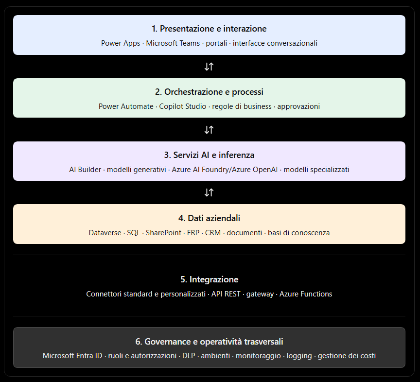
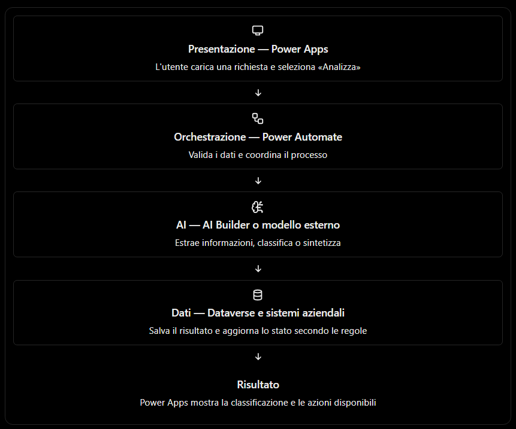

# Architettura di una soluzione AI aziendale con Microsoft Power Platform

In Microsoft Power Platform, una soluzione AI aziendale non coincide semplicemente con un modello di intelligenza artificiale inserito in un'applicazione. È un sistema composto da interfacce utente, logiche di orchestrazione, dati, servizi AI, integrazioni e controlli di sicurezza.

L'obiettivo è realizzare una soluzione in cui l'AI sia integrata nei processi aziendali, possa utilizzare informazioni autorizzate, interagire con i sistemi esistenti e produrre risultati verificabili, mantenendo sotto controllo accessi, costi e comportamento.

## 1. Architettura di una soluzione AI aziendale

### 1.1 I livelli architetturali

Una possibile architettura di riferimento è organizzata in sei livelli logici.



Questo schema rappresenta livelli logici, non una sequenza obbligatoria. Per esempio, un'app Power Apps può chiamare direttamente un'azione tramite un connettore, mentre un agente Copilot Studio può avviare un flusso Power Automate e usare fonti informative senza passare da una schermata Power Apps.

### 1.2 Responsabilità dei componenti

| Componente                      | Responsabilità principale                                                                                                          |
| ------------------------------- | ---------------------------------------------------------------------------------------------------------------------------------- |
| Power Apps                      | Presentare dati, raccogliere input e consentire all'utente di eseguire operazioni                                                  |
| Power Automate                  | Coordinare attività, sistemi, condizioni, approvazioni e processi asincroni                                                        |
| Dataverse                       | Gestire dati aziendali strutturati, relazioni, regole e autorizzazioni                                                             |
| Copilot Studio                  | Creare agenti conversazionali, gestire il dialogo e coordinare strumenti e fonti                                                   |
| AI Builder                      | Esporre capacità AI predefinite o configurabili all'interno dei flussi e delle app supportate                                      |
| Azure OpenAI / Azure AI Foundry | Accedere a modelli e servizi AI esterni alla piattaforma low-code, secondo le funzionalità e modalità di distribuzione disponibili |
| Connettori e API                | Collegare i componenti Power Platform ai sistemi e servizi esterni                                                                 |

Una soluzione può utilizzare tutti questi componenti, ma non è necessario farlo. La scelta dipende dai requisiti funzionali, dalla complessità dei processi, dai dati e dai vincoli di sicurezza.

### 1.3 Esempio aziendale: gestione intelligente delle richieste di assistenza

Immaginiamo un'azienda che riceva richieste di assistenza dai dipendenti.

1. Un dipendente inserisce una richiesta in Power Apps oppure conversa con un agente Copilot Studio.
2. L'applicazione recupera le informazioni dell'utente e del reparto.
3. Un flusso Power Automate avvia il processo di gestione.
4. Un servizio AI classifica la richiesta, ne sintetizza il contenuto e suggerisce una priorità.
5. Dataverse memorizza la richiesta, la categoria, lo stato e gli esiti delle elaborazioni.
6. Il flusso interroga il sistema di ticketing aziendale tramite un connettore o un'API.
7. Se necessario, una regola aziendale richiede l'approvazione di un responsabile.
8. L'utente visualizza lo stato tramite Power Apps o riceve una notifica.

Il modello AI può suggerire una categoria, ma l'applicazione deve applicare le regole aziendali che determinano se una richiesta può essere approvata automaticamente. L'AI non dovrebbe diventare, implicitamente, il sistema autorizzativo.

## 2. Relazione tra Power Apps, Power Automate, Dataverse e Copilot Studio

Questi quattro componenti hanno responsabilità differenti e complementari.

### Power Apps - il livello di presentazione

Power Apps permette di creare applicazioni aziendali web e mobile con cui gli utenti consultano informazioni, compilano moduli, modificano record e avviano operazioni.

Esempio: un operatore apre una richiesta, allega un documento e consulta lo stato di lavorazione.


### Power Automate - il livello di orchestrazione

Power Automate collega eventi, condizioni, azioni e sistemi esterni. Può eseguire processi automatici, gestire approvazioni e coordinare l'utilizzo dei servizi AI.

Esempio: quando arriva una richiesta, esegue la classificazione, registra il risultato, crea un ticket e invia una notifica.

### Dataverse - il livello dei dati applicativi

Dataverse offre tabelle, relazioni, regole, sicurezza a livello di record e colonna, oltre a meccanismi di integrazione con la piattaforma.

Esempio: memorizza la richiesta, il richiedente, la categoria assegnata, la priorità, lo stato e il riferimento al ticket esterno.


### Copilot Studio - il livello conversazionale e agentico

Copilot Studio consente di creare agenti che interpretano le richieste in linguaggio naturale, gestiscono il contesto della conversazione, consultano fonti e invocano strumenti o azioni.

Esempio: l'agente risponde a «A che punto è la mia richiesta?» e, se autorizzato e configurato, recupera lo stato dal sistema aziendale.

### 2.1 Come collaborano

La relazione non è una gerarchia rigida. Esistono diversi percorsi di esecuzione.

- Power Apps → Dataverse: lettura e aggiornamento diretto dei dati tramite le funzionalità della piattaforma.
- Power Apps → Power Automate: avvio di un flusso per operazioni complesse o integrazioni.
- Copilot Studio → Power Automate: invocazione di un flusso come strumento dell'agente.
- Copilot Studio → fonti informative: ricerca di informazioni autorizzate per costruire una risposta.
- Power Automate → AI Builder o servizio AI esterno: classificazione, estrazione, sintesi o generazione di contenuti.
- Power Automate → Dataverse: persistenza dei risultati e aggiornamento dello stato del processo.

Un principio progettuale importante è non duplicare inutilmente la stessa logica in più punti. Se una regola di processo deve essere utilizzata da un'app, da un agente e da un flusso pianificato, conviene individuare un componente riutilizzabile e definire chiaramente dove risiede la responsabilità.

## 3. Integrazione con sistemi e dati esterni

In un'azienda, i dati non risiedono necessariamente in Dataverse. Possono essere distribuiti tra ERP, CRM, sistemi MES e PLM, database relazionali, SharePoint, piattaforme documentali, servizi cloud e applicazioni on-premises.

L'architettura deve quindi stabilire dove risiedono i dati, come vengono consultati e aggiornati, quale sistema è autorevole e quali autorizzazioni si applicano.

Microsoft documenta diversi modelli d'integrazione per Power Platform e Copilot Studio, dai connettori predefiniti alle API personalizzate e ai servizi Azure.


### 3.1 I principali modelli d'integrazione

#### A. Integrazione tramite connettore

L'app o il flusso utilizza un connettore per leggere o scrivere dati in un servizio supportato.

Esempi: leggere elementi da SharePoint, recuperare informazioni da Salesforce, inviare un messaggio Outlook o interrogare un database attraverso il connettore appropriato.

Vantaggio: rapidità di implementazione e minore necessità di codice personalizzato.

#### B. Integrazione tramite database

L'applicazione o il processo accede a dati conservati in un database esterno tramite un connettore compatibile. In scenari selezionati, Dataverse può inoltre esporre dati esterni mediante tabelle virtuali, evitando di copiarli necessariamente in tabelle Dataverse.

È importante distinguere l'accesso ai dati dalla loro replica: sincronizzare un ERP in Dataverse può essere utile, ma comporta regole di aggiornamento, gestione dei conflitti e responsabilità sulla qualità del dato.

#### C. Integrazione tramite API

Quando non esiste un connettore adeguato, è possibile usare un connettore personalizzato o chiamare un'API tramite un componente di integrazione compatibile.

Un servizio come Azure API Management può centralizzare, dove opportuno, autenticazione, applicazione di policy, controllo del traffico e gestione delle API.

#### D. Integrazione tramite codice e middleware

Azure Functions, servizi applicativi o middleware aziendali possono gestire trasformazioni complesse, aggregazione di dati, protocolli specifici, logiche di sicurezza e integrazioni che non si prestano a una soluzione esclusivamente low-code.

### 3.2 Sistemi on-premises e cloud

Un sistema aziendale può trovarsi nel cloud oppure nella rete interna dell'organizzazione. La strategia di accesso cambia in base alla posizione e alle modalità supportate dal servizio.

Per alcuni scenari, il gateway dati locale (on-premises data gateway) permette ai servizi cloud compatibili di accedere a risorse della rete interna senza rendere direttamente pubblici i database. Non è però un gateway universale per qualsiasi API, protocollo o applicazione: occorre verificare il supporto dello specifico connettore e del servizio.

Per integrazioni più articolate, può essere necessario un endpoint raggiungibile in modo sicuro, un servizio intermedio o una soluzione di rete dedicata.

Esempio: un MES on-premises espone dati di produzione mediante un'API interna. Power Automate non dovrebbe presumere di poterla raggiungere direttamente. Si deve definire un percorso supportato, con identità, connettività e autorizzazioni appropriate.

### 3.3 Accesso diretto, copia e virtualizzazione dei dati

Questi tre approcci rispondono a esigenze differenti.

| Approccio                  | Come funziona                                                                                             | Quando è utile                                                                      |
| -------------------------- | --------------------------------------------------------------------------------------------------------- | ----------------------------------------------------------------------------------- |
| Accesso diretto            | La soluzione consulta il sistema sorgente quando serve                                                    | Dati che devono essere aggiornati e il sistema supporta interrogazioni adeguate     |
| Copia o sincronizzazione   | I dati vengono trasferiti in Dataverse o in un altro archivio                                             | Processi applicativi che richiedono dati locali, storicizzazione o disaccoppiamento |
| Tabelle virtuali Dataverse | I dati esterni sono esposti nel modello applicativo senza la normale duplicazione dei record in Dataverse | Integrazioni compatibili in cui è utile un'esperienza dati unificata                |

La scelta deve considerare latenza, disponibilità del sistema sorgente, volumi, frequenza di aggiornamento, capacità di scrittura, costi e coerenza dei dati.

### 3.4 Integrare i dati con l'AI non significa autorizzare l'AI a tutto

Supponiamo che un agente risponda a domande sulle commesse aziendali.

L'agente potrebbe utilizzare:

- Dataverse per le anagrafiche applicative;
- un ERP per importi, ordini e fatture;
- SharePoint per procedure e documentazione;
- un servizio AI per formulare una risposta comprensibile.

Tuttavia, l'agente deve accedere esclusivamente alle informazioni che l'utente è autorizzato a consultare. La disponibilità tecnica di una connessione non equivale al diritto di esporre tutti i dati attraverso una risposta generativa.

Occorre verificare come vengono applicate le autorizzazioni della fonte, le credenziali usate dal connettore, le autorizzazioni dell'utente e i controlli del componente intermedio. È inoltre opportuno fornire all'AI solo i dati necessari alla richiesta.

## 4. Ruolo dei connettori e delle API

### 4.1 Che cos'è un connettore Power Platform?

Un connettore è un componente che espone le funzionalità di un servizio attraverso un'interfaccia utilizzabile da Power Apps, Power Automate e, nei casi supportati, Copilot Studio.

Un connettore può esporre:

- Azioni: operazioni avviate dalla soluzione, come creare un record o inviare un messaggio.
- Trigger: eventi che possono avviare un flusso, come la creazione di un elemento.
- Parametri e risultati: informazioni richieste e restituite dalle operazioni.
- Gestione della connessione: modalità con cui la soluzione si autentica verso il servizio, secondo le funzionalità del connettore.

In termini tecnici, molti connettori rappresentano API, spesso REST, attraverso un'interfaccia strutturata. La documentazione Microsoft descrive i connettori come un meccanismo per esporre le API e integrare i servizi.


### 4.2 Tipologie di connettori

| Tipologia                | Descrizione                                                  | Quando sceglierla                                                             |
| ------------------------ | ------------------------------------------------------------ | ----------------------------------------------------------------------------- |
| Standard/predefinito     | Connettore già disponibile per un servizio supportato        | Quando le operazioni richieste sono già esposte                               |
| Premium                  | Connettore soggetto a specifici requisiti di licenza         | Quando il servizio o le funzionalità necessarie lo richiedono                 |
| Personalizzato           | Definito per esporre API aziendali o di terze parti          | Quando non esiste un connettore adatto                                        |
| Virtuale o di governance | Rappresentazione usata da specifici controlli amministrativi | Per applicare determinate policy, non come sinonimo di normale connettore API |

La distinzione tra standard e premium è importante, ma la licenza necessaria va verificata rispetto al prodotto, all'operazione, all'ambiente e alle condizioni contrattuali applicabili.

### 4.3 Che cos'è un'API?

Un'API (Application Programming Interface) è un'interfaccia che permette a un'applicazione di richiedere operazioni o dati a un altro sistema secondo un contratto definito.

Ad esempio, un sistema di gestione ordini potrebbe esporre:

```
GET /api/orders/ORD-1042
```

per recuperare un ordine, e:

```
POST /api/orders
Content-Type: application/json
```

per creare un ordine, se tali operazioni sono effettivamente previste dall'API.

Il metodo HTTP, il percorso e il formato del messaggio fanno parte del contratto dell'API. Il servizio può inoltre richiedere un token OAuth, una chiave, specifici ruoli o altre forme di autenticazione e autorizzazione.

### 4.4 API e connettori: differenze operative

#### Chiamata API diretta

L'applicazione o il componente deve gestire la richiesta HTTP, i parametri, l'autenticazione, gli errori e il formato della risposta.

#### Connettore

Espone le operazioni attraverso un'interfaccia più adatta agli strumenti Power Platform. Il connettore può incapsulare dettagli della richiesta, ma non elimina automaticamente problemi di autenticazione, limiti, errori o licenze.

#### Nota:

Un connettore personalizzato è particolarmente utile quando si vuole rendere una API aziendale riutilizzabile da più app, flussi o agenti, senza riscrivere ogni volta la stessa logica d'integrazione.

### 4.5 Quali responsabilità restano al progettista?

Anche con un connettore predefinito, occorre progettare:

1. Identità: con quale account o identità viene eseguita l'operazione?
2. Autorizzazioni: quali dati e azioni sono consentiti?
3. Gestione degli errori: cosa accade in caso di timeout, risposta non valida o servizio indisponibile?
4. Limiti e prestazioni: quante richieste possono essere eseguite e con quale frequenza?
5. Tracciabilità: come si correlano una richiesta utente, un flusso e la chiamata al sistema esterno?
6. Protezione dei dati: quali informazioni possono attraversare il confine tra sistemi?

I connettori riducono il lavoro d'integrazione, ma non sostituiscono il disegno architetturale.

## 5. Separazione tra presentazione, orchestrazione, dati e modello AI

La separazione dei livelli è uno dei principi più importanti per costruire una soluzione manutenibile. Non significa necessariamente creare quattro applicazioni o quattro servizi diversi: significa assegnare responsabilità chiare ai componenti.

### 5.1 Livello di presentazione

Responsabilità: interagire con l'utente e rappresentare le informazioni.

Componenti tipici:

- Power Apps per applicazioni aziendali;
- interfacce di chat di Copilot Studio;
- Power Pages per portali;
- Teams o altri canali supportati.

Questo livello dovrebbe occuparsi principalmente di schermate, input, navigazione, visualizzazione dei risultati e feedback all'utente.

Non dovrebbe contenere tutta la logica aziendale né chiamare direttamente un modello AI per ogni operazione senza considerare autorizzazioni, validazione e gestione degli errori.

Esempio: Power Apps mostra un ordine e consente all'utente di richiedere una sintesi AI. L'interfaccia presenta il risultato, ma non decide autonomamente se l'ordine può essere modificato.

### 5.2 Livello di orchestrazione

Responsabilità: decidere quali operazioni eseguire, in quale ordine e in base a quali condizioni.

Componenti tipici:

- Power Automate;
- azioni e strumenti di Copilot Studio;
- logica applicativa personalizzata;
- API intermedie e servizi di orchestrazione.

Questo livello gestisce la sequenza delle operazioni, le condizioni, i controlli di processo, le approvazioni e le interazioni con i sistemi esterni.

Esempio: un flusso riceve una richiesta, verifica che i campi obbligatori siano presenti, richiama un servizio AI, controlla il risultato, registra la richiesta e attiva un'approvazione se necessario.

È importante distinguere l'orchestrazione conversazionale da quella dei processi: Copilot Studio gestisce l'interazione dell'agente, mentre Power Automate è particolarmente adatto a coordinare workflow e azioni tra servizi. Le due funzioni possono collaborare.

### 5.3 Livello dei dati

Responsabilità: conservare, esporre e proteggere le informazioni aziendali.

Componenti tipici:

- Dataverse;
- SQL Server e database cloud;
- SharePoint;
- ERP, CRM e sistemi operativi;
- data lake, lakehouse e basi di conoscenza.

Per ogni dato è necessario stabilire quale sia la fonte autorevole (system of record). Per esempio, il sistema ERP può essere autorevole per gli ordini, mentre Dataverse contiene lo stato della pratica di assistenza che li riguarda.

Il livello dati deve inoltre gestire integrità, relazioni, autorizzazioni e ciclo di vita delle informazioni.

Esempio: il modello AI suggerisce una categoria per un ticket; il risultato viene salvato in Dataverse, ma il numero ufficiale dell'ordine continua a essere recuperato dall'ERP.

### 5.4 Livello del modello AI

Responsabilità: eseguire attività di intelligenza artificiale.

A seconda dello scenario, può comprendere:

- modelli generativi per sintesi, classificazione semantica e generazione di testo;
- funzionalità AI Builder per attività supportate, come estrazione o elaborazione di contenuti;
- modelli specializzati per previsione, riconoscimento o analisi;
- servizi esterni, ad esempio modelli ospitati in Azure.

Il modello non dovrebbe essere considerato automaticamente il responsabile delle regole aziendali. Produce una risposta, una previsione o una rappresentazione dei dati in base all'input e alle sue capacità.

Se un modello restituisce la priorità «alta», la soluzione deve comunque stabilire che cosa comporti tale priorità: chi riceve la notifica, quale SLA si applica e se sia necessaria un'approvazione.

### 5.5 Un esempio completo del flusso




Questo flusso non è obbligatorio per ogni soluzione. Per un agente conversazionale, Copilot Studio potrebbe essere il punto d'ingresso e richiamare Power Automate soltanto quando serve eseguire un'operazione. Per un'applicazione semplice, alcune funzioni potrebbero essere gestite direttamente da Power Apps e Dataverse.

### 5.6 Perché la separazione è utile?

- Manutenibilità: si può modificare il modello AI senza riprogettare l'interfaccia.
- Riusabilità: lo stesso processo può essere invocato da un'app, da un agente o da un evento automatico.
- Sicurezza: i controlli possono essere applicati nel punto corretto, senza affidarsi esclusivamente all'interfaccia.
- Testabilità: è possibile verificare separatamente la logica del processo, l'accesso ai dati e la qualità dell'output AI.
- Scalabilità: i componenti più sollecitati possono essere ottimizzati o sostituiti senza riscrivere l'intera soluzione.
- Tracciabilità: è più facile identificare dove si è verificato un errore e quale componente lo ha generato.

Una buona architettura non deve però diventare inutilmente complessa: suddividere un'applicazione semplice in molti servizi indipendenti può aumentare costi, latenza e difficoltà operative.

## 6. Criteri di scelta tra funzionalità native e componenti esterni

La scelta non è semplicemente tra una soluzione «low-code» e una «pro-code». La domanda corretta è: quale componente soddisfa il requisito con il miglior equilibrio tra funzionalità, sicurezza, costi, prestazioni e manutenibilità?

### 6.1 Quando preferire le funzionalità native

Le funzionalità native di Power Platform sono generalmente preferibili quando:

- il caso d'uso è supportato direttamente;
- il connettore necessario è disponibile e adeguato;
- i dati sono già gestiti in Dataverse o in servizi integrati;
- le esigenze di personalizzazione sono moderate;
- l'organizzazione vuole ridurre il codice da mantenere;
- le condizioni di licenza e capacità sono compatibili con il carico previsto.

Esempi:

- Power Apps e Dataverse per una gestione strutturata delle richieste;
- Power Automate per notifiche, approvazioni e workflow;
- Copilot Studio per un agente conversazionale che usa fonti e strumenti supportati;
- AI Builder per attività AI già disponibili e adeguate al requisito.

Il vantaggio è ridurre il lavoro necessario per sviluppare e integrare componenti personalizzati, senza rinunciare alla governance della piattaforma.

### 6.2 Quando valutare componenti esterni

È opportuno valutare Azure o altri componenti esterni quando emergono esigenze che le funzionalità native non soddisfano adeguatamente.

| Esigenza                                                                      | Componente da valutare                                                       |
| ----------------------------------------------------------------------------- | ---------------------------------------------------------------------------- |
| Modello generativo o configurazione non disponibile nella funzionalità nativa | Azure OpenAI o altri modelli/servizi supportati                              |
| Ricerca semantica su grandi collezioni documentali con requisiti specifici    | Azure AI Search o un servizio di ricerca adeguato                            |
| Elaborazioni complesse o algoritmi proprietari                                | Azure Functions o servizio applicativo personalizzato                        |
| API aziendali con contratti e policy specifici                                | Connettore personalizzato e/o Azure API Management                           |
| Integrazione con sistemi interni complessi                                    | Middleware, API intermedie o architettura d'integrazione dedicata            |
| Elaborazione dati ad alto volume o analisi su larga scala                     | Piattaforma dati appropriata, eventualmente Microsoft Fabric o servizi Azure |

Questi componenti non sono sostituti automatici di Power Platform. In genere estendono la soluzione, lasciando a Power Apps, Power Automate e Copilot Studio le responsabilità per cui risultano più adatti.

### 6.3 Matrice decisionale

## Valuta il tuo scenario


- Personalizzazione richiesta: scegliere tra
  - Bassa: funzionalità standard
  - Moderata: logiche configurabili e integrazioni comuni
  - Alta: algoritmi, logiche o controlli proprietari
- Integrazione con sistemi: scegliere tra
  - Standard: servizi con connettori disponibili
  - Personalizzata: API non coperte o protocolli specifici
  - On-premises: sistemi interni con vincoli di rete
- Volume e frequenza delle operazioni: scegliere tra
  - Basso: volumi limitati
  - Medio: uso aziendale regolare
  - Alto: picchi elevati o grandi volumi
- Requisiti di governance e controllo: scegliere tra
  - Standard: controlli ordinari della piattaforma
  - Elevati: audit, segregazione e controlli dettagliati
- Esigenza AI principale: scegliere tra
  - Funzionalità AI già disponibili in Power Platform
  - Modelli generativi con requisiti specifici
  - Modelli specializzati o algoritmi proprietari

### 6.4 I criteri da verificare prima di decidere

La matrice precedente offre un orientamento iniziale. Prima di adottare una soluzione, è opportuno valutare almeno questi aspetti.

#### Copertura funzionale

La funzionalità nativa esegue davvero tutte le operazioni richieste? Verifica input, output, formati, lingue, limiti di configurazione e capacità di gestire gli errori. Non scegliere un servizio esterno solo perché offre più opzioni, se quelle opzioni non servono al progetto.

#### Sicurezza e governance

Considera identità, autorizzazioni, gestione dei segreti, protezione dei dati, audit e criteri di prevenzione della perdita dei dati (DLP). Le policy Power Platform consentono, tra l'altro, di governare l'uso e la combinazione dei connettori negli ambienti interessati.

#### Prestazioni e affidabilità

Misura latenza, throughput, limiti delle API, quote, timeout e comportamento durante i picchi. Un processo che coinvolge un'app, un flusso, Dataverse e un servizio AI dipende dalla prestazione complessiva della catena, non soltanto dal modello.


####  Costi e licenze

Valuta le licenze Power Platform, i connettori premium, la capacità dei flussi, l'utilizzo AI, le risorse Azure e i costi operativi. Confronta il costo totale del ciclo di vita, non soltanto quello di sviluppo iniziale.

5\. Manutenibilità e ciclo di vita

Considera aggiornamenti, versionamento delle API, test, distribuzione tra ambienti di sviluppo e produzione, monitoraggio e competenze necessarie per la manutenzione. Le soluzioni Power Platform possono essere organizzate con soluzioni gestite e processi ALM, mentre i servizi esterni richiedono anche la gestione del proprio ciclo di vita.

### 6.5 Un esempio concreto di scelta

Un'azienda vuole creare un assistente che risponda alle domande sui prodotti e possa anche controllare lo stato degli ordini.

#### Scenario A — Domande sulle procedure

L'utente chiede come effettuare un reso o quali documenti allegare.

Scelta possibile: Copilot Studio con fonti informative aziendali autorizzate.

Non è necessariamente utile introdurre un modello esterno personalizzato se le funzionalità disponibili soddisfano il requisito.

#### Scenario B — Consultazione dello stato di un ordine

L'utente chiede se l'ordine è stato spedito.

Scelta possibile: Copilot Studio per la conversazione, connettore o API ERP per il recupero del dato, e Power Automate se serve orchestrare più operazioni.

Il modello formula la risposta, ma lo stato effettivo deve provenire dal sistema aziendale autorevole.

#### Scenario C — Analisi documentale complessa

L'utente carica centinaia di documenti tecnici e richiede confronti semantici specifici.

Scelta possibile: Power Platform per l'interfaccia e il processo, con servizi documentali, di ricerca o AI esterni per le capacità specialistiche necessarie.

La scelta va convalidata rispetto a volumi, qualità della ricerca, autorizzazioni, latenza e costi.

## 7. Principi architetturali da ricordare

Per progettare una soluzione AI aziendale con Power Platform, conviene applicare questi principi:

1. Assegnare una responsabilità chiara a ogni componente. Power Apps presenta, Power Automate orchestra i processi, Dataverse gestisce i dati applicativi e Copilot Studio coordina l'esperienza conversazionale.
2. Mantenere autorevoli i sistemi sorgente. Non chiedere al modello AI di inventare dati operativi che devono essere letti da ERP, CRM o altri sistemi.
3. Usare connettori e API come confini d'integrazione. Definire autenticazione, autorizzazioni, errori, limiti e tracciabilità.
4. Separare la generazione dalle decisioni critiche. Validazioni, autorizzazioni e operazioni irreversibili devono essere governate da regole esplicite.
5. Preferire il nativo quando soddisfa il requisito. Introdurre componenti esterni quando esiste un'esigenza funzionale, tecnica o organizzativa concreta.
6. Progettare sicurezza e governance fin dall'inizio. Non aggiungerle soltanto dopo che l'applicazione è stata realizzata.
7. Misurare il comportamento dell'intera soluzione. Qualità dell'AI, tempi di risposta, errori, costi e soddisfazione degli utenti devono essere verificati end-to-end.

Per approfondire con la documentazione ufficiale Microsoft, sono particolarmente utili il [Centro dell'Architettura Power Platform e Copilot Studio](https://learn.microsoft.com/it-it/power-platform/architecture/?utm_source=chatgpt.com), le [architetture di riferimento](https://learn.microsoft.com/it-it/power-platform/architecture/reference-architectures/?utm_source=chatgpt.com), la guida alla [progettazione dell'architettura di Copilot Studio](https://learn.microsoft.com/it-it/microsoft-copilot-studio/guidance/architecture-overview?utm_source=chatgpt.com) e la guida alle [strategie di integrazione](https://learn.microsoft.com/it-it/microsoft-copilot-studio/guidance/integrations?utm_source=chatgpt.com).


La regola conclusiva è questa: Power Platform costituisce il livello applicativo e di orchestrazione low-code; i servizi esterni ampliano le capacità quando necessario; i sistemi aziendali rimangono responsabili dei propri dati e delle proprie operazioni. L'AI è una capacità integrata in questa architettura, non un sostituto delle sue regole, dei suoi dati o dei suoi controlli.